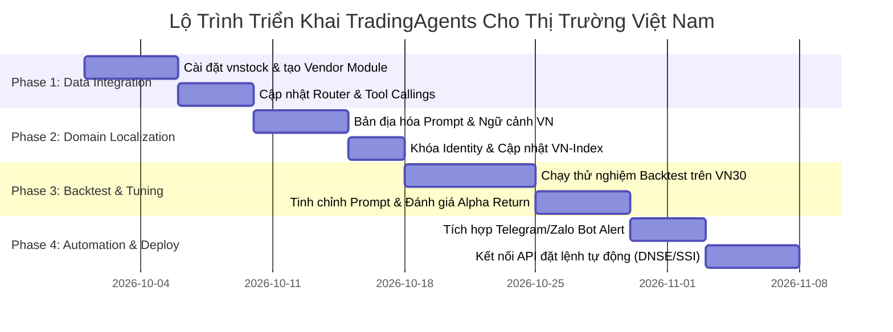

# Kế Hoạch Triển Khai Hệ Thống TradingAgents Cho Thị Trường Chứng Khoán Việt Nam (VN-Market Adaptation Plan)

## 1. Tổng Quan & Mục Tiêu Dự Án

Dự án này nhằm mục đích chuyển đổi và tối ưu hóa hệ thống Multi-Agent AI **TradingAgents** để hoạt động chuyên biệt trên thị trường chứng khoán Việt Nam (các sàn HOSE, HNX, UPCoM).

### Mục tiêu chính:
1. **Kết nối dữ liệu chứng khoán VN:** Tích hợp nguồn dữ liệu từ thư viện `vnstock` / `vnstock3` (hoặc API từ TCBS, Vietstock, CafeF) thay thế cho `yfinance` và `Alpha Vantage`.
2. **Bản địa hóa ngữ cảnh & luật thị trường:** Cập nhật quy tắc giao dịch (Biên độ giá ±7%, ±10%, ±15%, chu kỳ thanh toán T+2.5, dòng tiền Khối ngoại & Tự doanh, chỉ số tham chiếu VN-Index).
3. **Phân tích Tiếng Việt toàn diện:** Đảm bảo toàn bộ báo cáo từ các Agent (Market Analyst, Research Debate, Risk Debate, Portfolio Manager) được xuất bằng Tiếng Việt tự nhiên, chuẩn thuật ngữ tài chính Việt Nam.
4. **Tự động hóa thông báo & Đặt lệnh (Tùy chọn):** Kết nối Zalo/Telegram Bot xuất báo cáo hàng ngày và tích hợp API đặt lệnh (DNSE / SSI API).

---

## 2. Lộ Trình Triển Khai (4-Phase Roadmap)



---

## 3. Chi Tiết Các Bước Triển Khai Kỹ Thuật

### Phase 1: Tích Hợp Nguồn Dữ Liệu Thị Trường Việt Nam (`vnstock`)

#### 1.1. Cài đặt các thư viện phụ thuộc
```bash
pip install vnstock3 pandas numpy langchain-core langgraph
```

#### 1.2. Tạo Module Vendor Mới (`tradingagents/dataflows/vendors/vnstock_vendor.py`)
Tạo mới file vendor hỗ trợ lấy dữ liệu chứng khoán Việt Nam:

```python
"""Vendor module cho thị trường chứng khoán Việt Nam sử dụng vnstock."""

import pandas as pd
from vnstock import Stock

def get_stock_data_vn(symbol: str, start_date: str, end_date: str) -> str:
    """Lấy dữ liệu giá lịch sử OHLCV của mã chứng khoán VN."""
    try:
        stock = Stock(symbol=symbol.upper(), source='TCBS')
        df = stock.quote.history(start=start_date, end=end_date)
        if df.empty:
            return f"Không tìm thấy dữ liệu giá cho mã {symbol} từ {start_date} đến {end_date}."
        return df[['time', 'open', 'high', 'low', 'close', 'volume']].to_string(index=False)
    except Exception as e:
        return f"Lỗi khi lấy dữ liệu giá mã {symbol}: {str(e)}"

def get_fundamentals_vn(symbol: str, curr_date: str = "") -> str:
    """Lấy báo cáo tài chính & chỉ số định giá P/E, P/B, ROE, ROA."""
    try:
        stock = Stock(symbol=symbol.upper(), source='TCBS')
        ratios = stock.finance.ratio(period='quarter', lang='vi')
        overview = stock.company.overview()
        
        result = f"=== TỔNG QUAN DOANH NGHIỆP {symbol} ===\n"
        result += overview.to_string() + "\n\n"
        result += f"=== CHỈ SỐ TÀI CHÍNH QUÝ GẦN NHẤT ===\n"
        result += ratios.head(5).to_string()
        return result
    except Exception as e:
        return f"Lỗi khi lấy dữ liệu tài chính mã {symbol}: {str(e)}"

def get_foreign_flow_vn(symbol: str) -> str:
    """Lấy dữ liệu giao dịch Khối ngoại (Mua/Bán ròng)."""
    try:
        stock = Stock(symbol=symbol.upper(), source='TCBS')
        # Lấy lịch sử giao dịch nước ngoài
        df = stock.quote.history(start="2026-01-01", end="2026-09-25")
        return df[['time', 'foreign_buy_volume', 'foreign_sell_volume']].tail(10).to_string(index=False)
    except Exception as e:
        return f"Lỗi khi lấy dữ liệu khối ngoại mã {symbol}: {str(e)}"
```

#### 1.3. Đăng ký Router (`tradingagents/dataflows/router.py`)
Tích hợp vendor `vnstock` vào hàm `route_to_vendor`:

```python
# Import vendor mới
from tradingagents.dataflows.vendors.vnstock_vendor import (
    get_stock_data_vn,
    get_fundamentals_vn,
    get_foreign_flow_vn,
)

# Trong route_to_vendor():
if tool_name == "get_stock_data" and vendor == "vnstock":
    return get_stock_data_vn(symbol, start_date, end_date)
elif tool_name == "get_fundamentals" and vendor == "vnstock":
    return get_fundamentals_vn(symbol, curr_date)
```

---

### Phase 2: Bản Địa Hóa Ngữ Cảnh & Luật Thị Trường Việt Nam

#### 2.1. Cập nhật Khóa Identity Công Ty (`context.py`)
Chỉnh sửa hàm `resolve_instrument_identity` trong [tradingagents/agents/context.py](file:///d:/Huy%20Tuan%20Giang/BK/HK%20261/TradingAgents/tradingagents/agents/context.py) để tra cứu thông tin doanh nghiệp Việt Nam từ `vnstock`:

```python
def resolve_instrument_identity_vn(ticker: str) -> dict:
    """Tra cứu tên công ty & ngành nghề thực tế tại Việt Nam."""
    try:
        from vnstock import Stock
        info = Stock(symbol=ticker.upper(), source='TCBS').company.overview()
        return {
            "company_name": info.get("organ_name", ticker),
            "industry": info.get("icb_name3", "N/A"),
            "exchange": info.get("com_group_code", "HOSE"),
        }
    except Exception:
        return {"company_name": ticker, "industry": "N/A", "exchange": "HOSE"}
```

#### 2.2. Tiêm Luật Giao Dịch Vào System Prompt Của Các Agent
Cập nhật prompt hệ thống cho **Risk Management Team** và **Portfolio Manager**:

> **Quy tắc thị trường chứng khoán Việt Nam cần tuân thủ:**
> 1. **Biên độ giao dịch trong ngày (Price Fluctuation Limit):**
>    - Sàn HOSE: ±7% so với giá tham chiếu.
>    - Sàn HNX: ±10% so với giá tham chiếu.
>    - Sàn UPCoM: ±15% so với giá bình quân phiên trước.
> 2. **Chu kỳ thanh toán (Settlement):** Cổ phiếu mua sẽ về tài khoản vào chiều ngày **T+2.5**. Do đó, mọi chiến lược lướt sóng T+0 (Day trading) thông thường không áp dụng được (trừ khi có tài khoản kho/tài khoản đối ứng).
> 3. **Chỉ số tham chiếu (Benchmark):** Sử dụng chỉ số **VN-INDEX** để đánh giá hiệu quả Alpha Return (thay vì chỉ số SPY của Mỹ).
> 4. **Yếu tố Dòng tiền:** Đánh giá kỹ động thái Mua/Bán ròng của **Khối ngoại (Foreign Investors)** và **Tự doanh Công ty Chứng khoán**.

---

### Phase 3: Thử Nghiệm & Đánh Giá Hiệu Quả (Backtesting trên VN30)

#### 3.1. Kịch bản Backtest
- **Danh mục thử nghiệm:** Danh mục VN30 (HPG, FPT, VNM, TCB, VCB, MBB, MWG, MSN, SSI, VIC).
- **Khung thời gian:** Chạy lưới dữ liệu từ 01/01/2026 đến 01/09/2026 (tần suất 1 tuần/lần).
- **Chỉ số đánh giá:**
  - Tỷ lệ tín hiệu chính xác (Hit Rate của các khuyến nghị `Buy`/`Overweight`).
  - Lợi nhuận vượt trội (Alpha Return) so với VN-Index cùng thời điểm.

#### 3.2. Chạy thử nghiệm bằng file `main_vn.py`
Tạo file khởi chạy mẫu cho thị trường VN `main_vn.py`:

```python
from tradingagents.default_config import DEFAULT_CONFIG
from tradingagents.graph.trading_graph import TradingAgentsGraph

config = DEFAULT_CONFIG.copy()
config["output_language"] = "Vietnamese"
config["core_stock_apis"] = "vnstock"
config["technical_indicators"] = "vnstock"
config["fundamental_data"] = "vnstock"

# Khởi tạo đồ thị
ta = TradingAgentsGraph(debug=True, config=config)

# Chạy phân tích cho cổ phiếu FPT ngày 2026-09-25
state, signal = ta.propagate("FPT", "2026-09-25")

print("=== QUYẾT ĐỊNH GIAO DỊCH CUỐI CÙNG ===")
print(f"Tín hiệu: {signal}")
print(state["final_trade_decision"])

# Lưu cây báo cáo Markdown
report_path = ta.save_reports(state, "FPT")
print(f"Báo cáo chi tiết đã lưu tại: {report_path}")
```

---

### Phase 4: Tự Động Hóa Thông Báo & Tích Hợp API Đặt Lệnh

#### 4.1. Tự động hóa báo cáo qua Telegram Bot
- Viết script `bot_notifier.py` lắng nghe khi hệ thống `TradingAgents` hoàn thành phân tích.
- Tự động định dạng báo cáo tóm tắt và gửi vào Channel/Group Telegram hàng ngày vào 8:00 AM (trước giờ mở cửa thị trường).

```
📌 BÁO CÁO PHÂN TÍCH TÍN HIỆU VN30 - NGÀY 26/09/2026
Mã chứng khoán: FPT (Công ty Cổ phần FPT)
Khuyến nghị: OVERWEIGHT (Tăng tỷ trọng)
Mức giá vào lệnh khuyến nghị: 132.000 - 134.000 VNĐ
Mục tiêu chốt lời (Target): 148.000 VNĐ (+11.5%)
Cắt lỗ (Stop-loss): 127.000 VNĐ (-4.5%)
Lý do chính: Tăng trưởng doanh thu mảng IT nước ngoài + Động thái Mua ròng 3 phiên liên tiếp của Khối ngoại.
```

#### 4.2. Tích hợp đặt lệnh tự động (Tùy chọn cho Algorithmic Trader)
- Kết nối API đặt lệnh của **DNSE (Enlighten API)** hoặc **SSI (FastConnect API)**.
- Khi `Portfolio Manager` phát ra tín hiệu `Buy` hoặc `Sell` kèm khối lượng (Position Size), hệ thống tự động sinh lệnh chờ (`LO`) hoặc lệnh thị trường (`MP`).

---

## 4. Bảng Đánh Giá Rủi Ro & Giải Pháp Khắc Phục (Risk Management)

| Rủi ro tiềm ẩn | Mức độ | Nguyên nhân | Giải pháp khắc phục |
| :--- | :--- | :--- | :--- |
| **Giới hạn truy cập API (Rate Limit / Blown Request)** | Trung bình | `vnstock` bị bên nguồn (TCBS/VNDirect) chặn IP do request quá dầy. | Cấu hình Caching dữ liệu tại local (`data_cache_dir`) & thêm độ trễ `time.sleep()` giữa các lượt gọi. |
| **Sai lệch định dạng BCTC Tiếng Việt** | Thấp | Cấu trúc BCTC doanh nghiệp Việt Nam khác cấu trúc SEC EDGAR của Mỹ. | Viết hàm Chuẩn hóa Schema dữ liệu BCTC trong `vnstock_vendor.py` trước khi đưa vào LLM. |
| **Rủi ro rò rỉ dữ liệu (Lookahead Bias)** | Cao | Lấy dữ liệu BCTC quý tương lai trong quá trình Backtest. | Áp dụng nghiêm ngặt hàm cắt ngày `as_of(curr_date)` theo tham số `trade_date`. |
| **Độ trễ T+2.5 gây rủi ro đảo chiều** | Trung bình | Tín hiệu mua đúng ngày T nhưng đến T+2.5 thị trường đảo chiều bất ngờ. | Cấu hình cho **Conservative Analyst** ưu tiên đánh giá rủi ro thanh khoản và xu hướng VN-Index trước khi duyệt lệnh. |

---

## 5. Tổng Kết Kế Hoạch

Việc chuyển đổi **TradingAgents** sang thị trường Việt Nam hoàn toàn khả thi trong vòng **3 - 4 tuần** làm việc. Việc tận dụng hạ tầng mã nguồn mô-đun hóa của dự án giúp giảm thiểu 80% công sức viết lại code, chỉ tập trung vào việc **kết nối nguồn dữ liệu `vnstock`** và **bản địa hóa prompt tài chính Việt Nam**.
