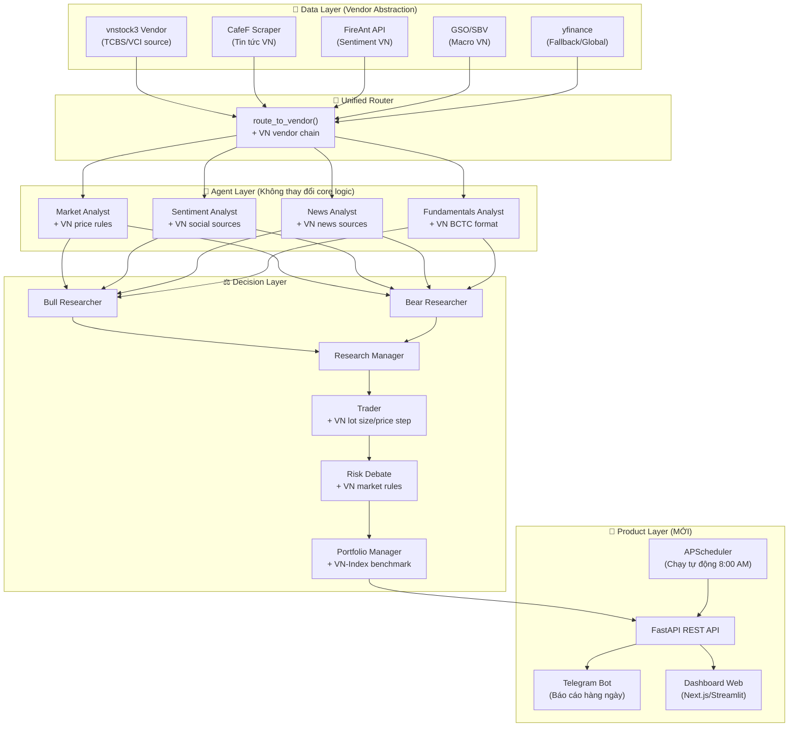
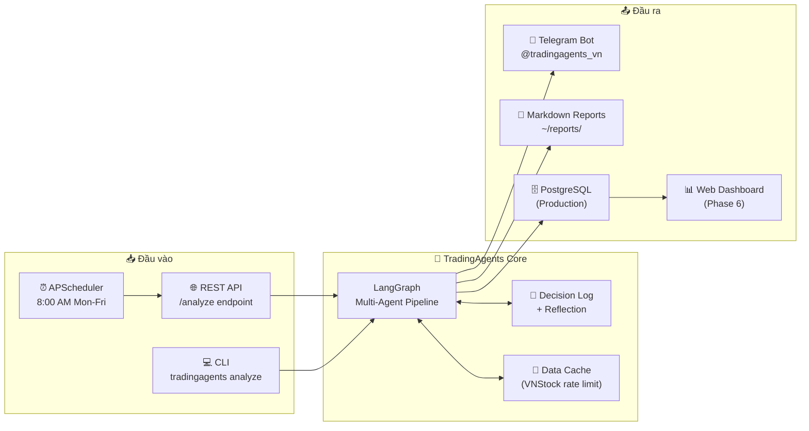
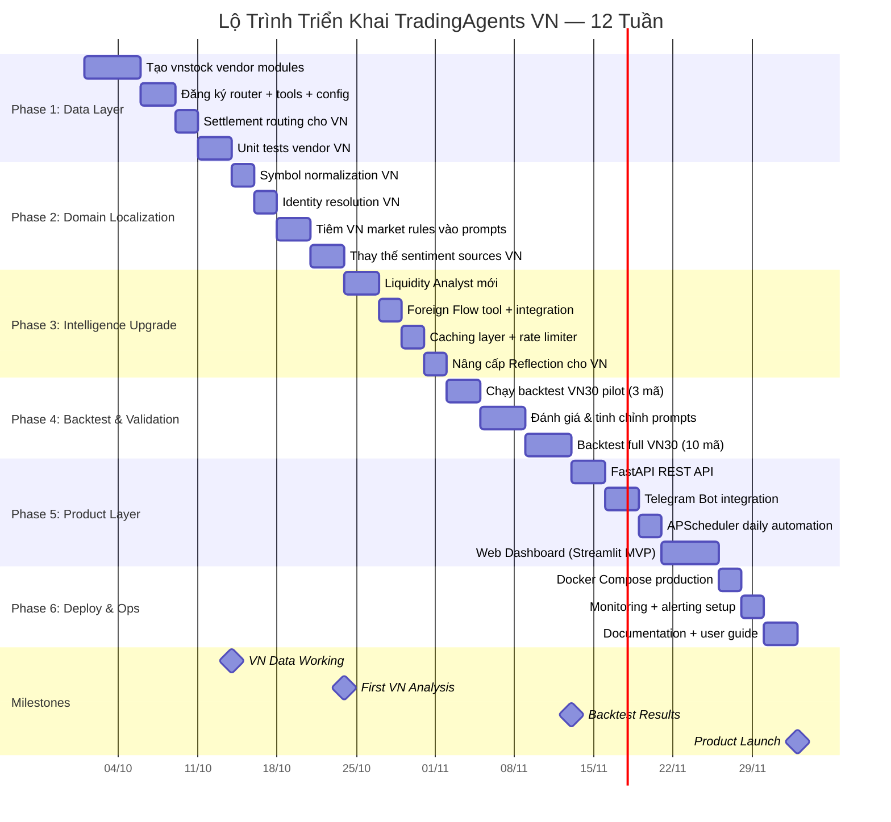

# 🇻🇳 Kế Hoạch Tổng Thể: Ứng Dụng TradingAgents Vào Thị Trường Việt Nam — Từ Nghiên Cứu Đến Sản Phẩm Thực Tế

> [!IMPORTANT]
> Tài liệu này là bản kế hoạch toàn diện, được xây dựng dựa trên phân tích sâu **toàn bộ mã nguồn TradingAgents** (15+ modules, 3000+ LOC). Mỗi hạng mục đều chỉ rõ **file cần sửa, code cần thêm, và thứ tự ưu tiên**.

---

## Mục Lục

1. [Phân Tích Gap Hiện Tại](#1-phân-tích-gap-giữa-hệ-thống-hiện-tại-và-thị-trường-việt-nam)
2. [Kiến Trúc Tổng Thể Sau Chuyển Đổi](#2-kiến-trúc-tổng-thể-sau-chuyển-đổi)
3. [Phase 1: Data Layer — Vendor vnstock](#3-phase-1-data-layer--tích-hợp-vendor-vnstock-2-tuần)
4. [Phase 2: Domain Localization](#4-phase-2-domain-localization--bản-địa-hóa-ngữ-cảnh-15-tuần)
5. [Phase 3: Agent Intelligence Upgrade](#5-phase-3-agent-intelligence-upgrade--nâng-cấp-trí-tuệ-agent-2-tuần)
6. [Phase 4: Backtesting & Validation](#6-phase-4-backtesting--validation-15-tuần)
7. [Phase 5: Product Layer — API, Bot, UI](#7-phase-5-product-layer--từ-tool-nghiên-cứu-thành-sản-phẩm-3-tuần)
8. [Phase 6: Deployment & Operations](#8-phase-6-deployment--operations-1-tuần)
9. [Bảng Rủi Ro & Giải Pháp](#9-bảng-rủi-ro--giải-pháp-khắc-phục)
10. [Lộ Trình Tổng Hợp (Gantt)](#10-lộ-trình-tổng-hợp)
11. [Ước Tính Chi Phí Vận Hành](#11-ước-tính-chi-phí-vận-hành)

---

## 1. Phân Tích Gap Giữa Hệ Thống Hiện Tại Và Thị Trường Việt Nam

### 1.1. Ma trận đánh giá từng module

| Module / File | Tình trạng hiện tại | Gap với VN Market | Mức độ sửa |
| :--- | :--- | :--- | :---: |
| **Data Vendors** ([router.py](file:///d:/Huy%20Tuan%20Giang/BK/HK%20261/TradingAgents/tradingagents/dataflows/router.py)) | Chỉ hỗ trợ `yfinance`, `alpha_vantage`, `fred`, `polymarket` | Không có vendor nào hỗ trợ mã VN (HOSE/HNX/UPCoM) | 🔴 **Tạo mới** |
| **Symbol Normalization** ([symbols.py](file:///d:/Huy%20Tuan%20Giang/BK/HK%20261/TradingAgents/tradingagents/dataflows/symbols.py)) | Chỉ chuẩn hóa HK, Shanghai, Forex, Crypto | Mã VN (FPT, VNM, HPG) không có quy tắc chuẩn hóa | 🟡 **Mở rộng** |
| **Identity Resolution** ([context.py](file:///d:/Huy%20Tuan%20Giang/BK/HK%20261/TradingAgents/tradingagents/agents/context.py)) | Dùng `yfinance.get_company_profile()` | yfinance không nhận mã VN → identity = `{}` → mất neo doanh nghiệp | 🔴 **Thay thế** |
| **Benchmark Map** ([default_config.py](file:///d:/Huy%20Tuan%20Giang/BK/HK%20261/TradingAgents/tradingagents/default_config.py#L160-L172)) | Chỉ có `.NS`, `.HK`, `.T`, `.SS`, `.SZ`... Không có VN | Alpha Return tính theo SPY — vô nghĩa với cổ phiếu VN | 🟢 **Config** |
| **Settlement** ([settlement.py](file:///d:/Huy%20Tuan%20Giang/BK/HK%20261/TradingAgents/tradingagents/graph/settlement.py)) | Dùng `get_closes()` từ Yahoo | Yahoo không có lịch sử giá VN → settlement fail → memory log không học được | 🔴 **Tạo mới** |
| **Sentiment Sources** ([sentiment_analyst.py](file:///d:/Huy%20Tuan%20Giang/BK/HK%20261/TradingAgents/tradingagents/agents/analysts/sentiment_analyst.py)) | StockTwits + Reddit (r/wallstreetbets, r/stocks) | Nhà đầu tư VN không dùng StockTwits/Reddit → sentiment = rỗng | 🔴 **Thay thế** |
| **News Sources** ([news_analyst.py](file:///d:/Huy%20Tuan%20Giang/BK/HK%20261/TradingAgents/tradingagents/agents/analysts/news_analyst.py)) | Yahoo Finance News | Yahoo Finance không có tin VN → phân tích tin tức = thiếu | 🟡 **Bổ sung** |
| **Macro Data** ([fred.py](file:///d:/Huy%20Tuan%20Giang/BK/HK%20261/TradingAgents/tradingagents/dataflows/vendors/fred.py)) | FRED (Fed Funds Rate, CPI Mỹ, ...) | Cần thêm lãi suất SBV, CPI VN, tỷ giá USD/VND | 🟡 **Bổ sung** |
| **Prediction Markets** ([polymarket.py](file:///d:/Huy%20Tuan%20Giang/BK/HK%20261/TradingAgents/tradingagents/dataflows/vendors/polymarket.py)) | Polymarket (US-centric) | Không có thị trường dự đoán cho VN → optional, degrade gracefully | 🟢 **Giữ nguyên** |
| **Risk Debate Prompts** ([aggressive_debator.py](file:///d:/Huy%20Tuan%20Giang/BK/HK%20261/TradingAgents/tradingagents/agents/risk_mgmt/aggressive_debator.py)) | Không đề cập biên độ giá, T+2.5, quy tắc margin | Thiếu luật đặc thù VN → Risk Agent không đánh giá đúng rủi ro | 🟡 **Bổ sung prompt** |
| **Trader Agent** ([trader.py](file:///d:/Huy%20Tuan%20Giang/BK/HK%20261/TradingAgents/tradingagents/agents/trader/trader.py)) | Đặt lệnh theo USD, không có khái niệm lô (board lot) | VN giao dịch theo lô 100cp, giá bước nhảy 10/50/100 VNĐ | 🟡 **Bổ sung prompt** |
| **Portfolio Model** ([portfolio.py](file:///d:/Huy%20Tuan%20Giang/BK/HK%20261/TradingAgents/tradingagents/portfolio.py)) | Generic (currency-neutral) | Cần thêm VNĐ context, margin ratio VN | 🟢 **Config** |

### 1.2. Điểm mạnh có thể tận dụng ngay

> [!TIP]
> Kiến trúc hiện tại đã được thiết kế **module-hóa tốt** với pattern Vendor → Router → Tool → Agent. Nhờ đó, việc thêm vendor mới cho VN market **không cần viết lại bất kỳ Agent logic nào** — chỉ cần:
> 1. Tạo vendor module mới trong `vendors/`
> 2. Đăng ký vào `VENDOR_METHODS` trong `router.py`
> 3. Cập nhật `default_config.py`

---

## 2. Kiến Trúc Tổng Thể Sau Chuyển Đổi



---

## 3. Phase 1: Data Layer — Tích Hợp Vendor vnstock (2 tuần)

### 3.1. Tạo VNStock Vendor Module

**File mới:** `tradingagents/dataflows/vendors/vnstock/`

```
vendors/vnstock/
├── __init__.py
├── market.py          # OHLCV, chỉ báo kỹ thuật
├── fundamentals.py    # BCTC, chỉ số tài chính
├── news.py            # Tin tức từ TCBS/CafeF
├── sentiment.py       # Tâm lý thị trường VN
├── foreign_flow.py    # Dòng tiền khối ngoại + tự doanh
└── identity.py        # Tra cứu company profile VN
```

**Chi tiết `market.py`:**

```python
"""OHLCV + Technical Indicators cho mã chứng khoán Việt Nam."""

import logging
from datetime import datetime

import pandas as pd
from vnstock3 import Vnstock

from tradingagents.dataflows.errors import NoMarketDataError

logger = logging.getLogger(__name__)

# Cache Vnstock instance per source
_stock_cache: dict[tuple[str, str], Vnstock] = {}


def _get_stock(symbol: str, source: str = "TCBS") -> Vnstock:
    key = (symbol.upper(), source)
    if key not in _stock_cache:
        _stock_cache[key] = Vnstock().stock(symbol=symbol.upper(), source=source)
    return _stock_cache[key]


def get_stock_data_vn(symbol: str, start_date: str, end_date: str) -> str:
    """Lấy dữ liệu giá lịch sử OHLCV, tuân thủ point-in-time."""
    try:
        stock = _get_stock(symbol)
        df = stock.quote.history(start=start_date, end=end_date, interval="1D")
        if df is None or df.empty:
            raise NoMarketDataError(symbol, symbol, f"Không có dữ liệu từ {start_date} đến {end_date}")

        # Chuẩn hóa tên cột về format chung của hệ thống
        col_map = {
            "time": "Date", "open": "Open", "high": "High",
            "low": "Low", "close": "Close", "volume": "Volume"
        }
        df = df.rename(columns=col_map)
        return df[["Date", "Open", "High", "Low", "Close", "Volume"]].to_string(index=False)
    except NoMarketDataError:
        raise
    except Exception as e:
        logger.warning("VNStock: Lỗi lấy dữ liệu giá %s: %s", symbol, e)
        raise NoMarketDataError(symbol, symbol, str(e)) from e


def get_indicators_vn(symbol: str, indicator: str, curr_date: str, look_back_days: int = 30) -> str:
    """Tính chỉ báo kỹ thuật từ dữ liệu OHLCV VN."""
    from datetime import timedelta
    start = (datetime.strptime(curr_date, "%Y-%m-%d") - timedelta(days=look_back_days + 60)).strftime("%Y-%m-%d")

    stock = _get_stock(symbol)
    df = stock.quote.history(start=start, end=curr_date, interval="1D")
    if df is None or df.empty:
        return f"Không có dữ liệu để tính {indicator} cho {symbol}"

    # Tự tính indicators bằng pandas (không phụ thuộc vào alpha_vantage)
    close = df["close"].astype(float)

    indicator = indicator.lower().strip()
    if indicator == "rsi":
        delta = close.diff()
        gain = delta.where(delta > 0, 0).rolling(14).mean()
        loss = (-delta.where(delta < 0, 0)).rolling(14).mean()
        rs = gain / loss
        rsi = 100 - (100 / (1 + rs))
        return f"RSI (14-day) for {symbol} as of {curr_date}:\n{rsi.tail(look_back_days).to_string()}"

    elif indicator == "macd":
        ema12 = close.ewm(span=12).mean()
        ema26 = close.ewm(span=26).mean()
        macd_line = ema12 - ema26
        signal = macd_line.ewm(span=9).mean()
        histogram = macd_line - signal
        result = pd.DataFrame({"MACD": macd_line, "Signal": signal, "Histogram": histogram})
        return f"MACD for {symbol} as of {curr_date}:\n{result.tail(look_back_days).to_string()}"

    elif indicator in ("sma", "ma", "moving_average"):
        sma20 = close.rolling(20).mean()
        sma50 = close.rolling(50).mean()
        result = pd.DataFrame({"Close": close, "SMA20": sma20, "SMA50": sma50})
        return f"Moving Averages for {symbol} as of {curr_date}:\n{result.tail(look_back_days).to_string()}"

    elif indicator in ("bollinger", "bbands", "bollinger_bands"):
        sma20 = close.rolling(20).mean()
        std20 = close.rolling(20).std()
        result = pd.DataFrame({
            "Close": close, "Upper": sma20 + 2*std20,
            "Middle": sma20, "Lower": sma20 - 2*std20
        })
        return f"Bollinger Bands for {symbol} as of {curr_date}:\n{result.tail(look_back_days).to_string()}"

    else:
        return f"Chỉ báo '{indicator}' chưa được hỗ trợ. Các chỉ báo khả dụng: rsi, macd, sma, bollinger"


def get_closes_vn(symbol: str, start_date: str, end_date: str) -> pd.Series:
    """Trả về Series giá đóng cửa cho settlement (tính Alpha Return)."""
    stock = _get_stock(symbol)
    df = stock.quote.history(start=start_date, end=end_date, interval="1D")
    if df is None or df.empty:
        return pd.Series(dtype=float)
    df["time"] = pd.to_datetime(df["time"])
    df = df.set_index("time").sort_index()
    return df["close"].astype(float)
```

**Chi tiết `fundamentals.py`:**

```python
"""Dữ liệu tài chính doanh nghiệp Việt Nam."""

import logging
from vnstock3 import Vnstock

logger = logging.getLogger(__name__)


def get_fundamentals_vn(symbol: str, curr_date: str = "") -> str:
    """Báo cáo tổng hợp tài chính: overview + ratios + income statement."""
    try:
        stock = Vnstock().stock(symbol=symbol.upper(), source="TCBS")

        parts = [f"=== BÁO CÁO TÀI CHÍNH: {symbol.upper()} ===\n"]

        # 1. Tổng quan doanh nghiệp
        try:
            overview = stock.company.overview()
            if overview is not None and not overview.empty:
                parts.append("--- TỔNG QUAN DOANH NGHIỆP ---")
                parts.append(overview.to_string())
        except Exception as e:
            parts.append(f"(Không lấy được tổng quan: {e})")

        # 2. Chỉ số tài chính theo quý
        try:
            ratios = stock.finance.ratio(period="quarter", lang="vi")
            if ratios is not None and not ratios.empty:
                parts.append("\n--- CHỈ SỐ TÀI CHÍNH (5 QUÝ GẦN NHẤT) ---")
                parts.append(ratios.head(5).to_string())
        except Exception as e:
            parts.append(f"(Không lấy được chỉ số tài chính: {e})")

        # 3. Báo cáo thu nhập
        try:
            income = stock.finance.income_statement(period="quarter", lang="vi")
            if income is not None and not income.empty:
                parts.append("\n--- BÁO CÁO THU NHẬP (4 QUÝ GẦN NHẤT) ---")
                parts.append(income.head(4).to_string())
        except Exception as e:
            parts.append(f"(Không lấy được báo cáo thu nhập: {e})")

        # 4. Bảng cân đối kế toán
        try:
            balance = stock.finance.balance_sheet(period="quarter", lang="vi")
            if balance is not None and not balance.empty:
                parts.append("\n--- BẢNG CÂN ĐỐI KẾ TOÁN (4 QUÝ GẦN NHẤT) ---")
                parts.append(balance.head(4).to_string())
        except Exception as e:
            parts.append(f"(Không lấy được BCĐKT: {e})")

        return "\n".join(parts)
    except Exception as e:
        return f"Lỗi tổng hợp dữ liệu tài chính {symbol}: {e}"


def get_balance_sheet_vn(symbol: str, freq: str = "quarterly", curr_date: str = None) -> str:
    try:
        period = "quarter" if "quarter" in freq.lower() else "year"
        stock = Vnstock().stock(symbol=symbol.upper(), source="TCBS")
        df = stock.finance.balance_sheet(period=period, lang="vi")
        if df is None or df.empty:
            return f"Không có dữ liệu BCĐKT cho {symbol}"
        return df.head(8).to_string()
    except Exception as e:
        return f"Lỗi lấy BCĐKT {symbol}: {e}"


def get_cashflow_vn(symbol: str, freq: str = "quarterly", curr_date: str = None) -> str:
    try:
        period = "quarter" if "quarter" in freq.lower() else "year"
        stock = Vnstock().stock(symbol=symbol.upper(), source="TCBS")
        df = stock.finance.cash_flow(period=period, lang="vi")
        if df is None or df.empty:
            return f"Không có dữ liệu dòng tiền cho {symbol}"
        return df.head(8).to_string()
    except Exception as e:
        return f"Lỗi lấy cash flow {symbol}: {e}"


def get_income_statement_vn(symbol: str, freq: str = "quarterly", curr_date: str = None) -> str:
    try:
        period = "quarter" if "quarter" in freq.lower() else "year"
        stock = Vnstock().stock(symbol=symbol.upper(), source="TCBS")
        df = stock.finance.income_statement(period=period, lang="vi")
        if df is None or df.empty:
            return f"Không có dữ liệu báo cáo thu nhập cho {symbol}"
        return df.head(8).to_string()
    except Exception as e:
        return f"Lỗi lấy income statement {symbol}: {e}"


def get_company_profile_vn(symbol: str) -> dict:
    """Tra cứu identity doanh nghiệp VN cho context.py."""
    try:
        stock = Vnstock().stock(symbol=symbol.upper(), source="TCBS")
        overview = stock.company.overview()
        if overview is None or overview.empty:
            return {}
        row = overview.iloc[0] if len(overview) > 0 else overview
        return {
            "longName": row.get("organ_name", symbol),
            "shortName": row.get("organ_short_name", symbol),
            "sector": row.get("icb_name2", None),
            "industry": row.get("icb_name3", None),
            "exchange": row.get("com_group_code", "HOSE"),
        }
    except Exception:
        return {}
```

**Chi tiết `foreign_flow.py` (TOOL MỚI — đặc thù VN):**

```python
"""Dòng tiền Khối ngoại & Tự doanh — yếu tố quan trọng nhất đặc thù VN."""

import logging
from vnstock3 import Vnstock

logger = logging.getLogger(__name__)


def get_foreign_flow_vn(symbol: str, curr_date: str = "", look_back_days: int = 20) -> str:
    """Phân tích dòng tiền Khối ngoại mua/bán ròng."""
    try:
        from datetime import datetime, timedelta
        end = curr_date or datetime.now().strftime("%Y-%m-%d")
        start = (datetime.strptime(end, "%Y-%m-%d") - timedelta(days=look_back_days + 10)).strftime("%Y-%m-%d")

        stock = Vnstock().stock(symbol=symbol.upper(), source="TCBS")
        df = stock.quote.history(start=start, end=end, interval="1D")

        if df is None or df.empty:
            return f"Không có dữ liệu giao dịch khối ngoại cho {symbol}"

        # Tính net buy/sell volume
        if "foreignBuyVolume" in df.columns and "foreignSellVolume" in df.columns:
            df["net_foreign"] = df["foreignBuyVolume"] - df["foreignSellVolume"]
            total_net = df["net_foreign"].sum()
            recent_5d = df["net_foreign"].tail(5).sum()

            result = f"=== DÒNG TIỀN KHỐI NGOẠI: {symbol.upper()} ===\n"
            result += f"Tổng mua/bán ròng {look_back_days} phiên: {total_net:,.0f} cp\n"
            result += f"Mua/Bán ròng 5 phiên gần nhất: {recent_5d:,.0f} cp\n"
            result += f"Xu hướng: {'MUA RÒNG' if total_net > 0 else 'BÁN RÒNG'}\n\n"
            result += df[["time", "foreignBuyVolume", "foreignSellVolume", "net_foreign"]].tail(10).to_string(index=False)
            return result
        else:
            return f"Dữ liệu khối ngoại không khả dụng cho {symbol} từ nguồn hiện tại."
    except Exception as e:
        return f"Lỗi lấy dữ liệu khối ngoại {symbol}: {e}"
```

### 3.2. Đăng Ký Vendor Vào Router

**File sửa:** [router.py](file:///d:/Huy%20Tuan%20Giang/BK/HK%20261/TradingAgents/tradingagents/dataflows/router.py)

**Thay đổi cần làm:**

```diff
 # Thêm imports
+from tradingagents.dataflows.vendors.vnstock.market import (
+    get_stock_data_vn,
+    get_indicators_vn,
+)
+from tradingagents.dataflows.vendors.vnstock.fundamentals import (
+    get_fundamentals_vn,
+    get_balance_sheet_vn,
+    get_cashflow_vn,
+    get_income_statement_vn,
+)

 VENDOR_LIST = [
     "yfinance",
     "sec_edgar",
     "fred",
     "polymarket",
     "alpha_vantage",
+    "vnstock",
 ]

 VENDOR_METHODS = {
     "get_stock_data": {
         "alpha_vantage": get_alpha_vantage_stock,
         "yfinance": get_YFin_data_online,
+        "vnstock": get_stock_data_vn,
     },
     "get_indicators": {
         "alpha_vantage": get_alpha_vantage_indicator,
         "yfinance": get_stock_stats_indicators_window,
+        "vnstock": get_indicators_vn,
     },
     "get_fundamentals": {
         "alpha_vantage": get_alpha_vantage_fundamentals,
         "yfinance": get_yfinance_fundamentals,
+        "vnstock": get_fundamentals_vn,
     },
     "get_balance_sheet": {
         ...
+        "vnstock": get_balance_sheet_vn,
     },
     "get_cashflow": {
         ...
+        "vnstock": get_cashflow_vn,
     },
     "get_income_statement": {
         ...
+        "vnstock": get_income_statement_vn,
     },
+    # Tool mới đặc thù VN
+    "get_foreign_flow": {
+        "vnstock": get_foreign_flow_vn,
+    },
 }
```

### 3.3. Thêm Tool mới: `get_foreign_flow`

**File sửa:** [tools.py](file:///d:/Huy%20Tuan%20Giang/BK/HK%20261/TradingAgents/tradingagents/agents/tools.py)

```python
@tool
def get_foreign_flow(
    symbol: Annotated[str, "mã chứng khoán VN, ví dụ FPT, VNM, HPG"],
    curr_date: Annotated[str, "ngày phân tích, YYYY-mm-dd"],
    look_back_days: Annotated[int, "số phiên nhìn lại"] = 20,
    trade_date: Annotated[str, InjectedState("trade_date")] = "",
) -> str:
    """Lấy dữ liệu giao dịch Khối ngoại (Foreign Investors) mua/bán ròng.
    Chỉ khả dụng cho cổ phiếu Việt Nam trên sàn HOSE/HNX/UPCoM.
    """
    return route_to_vendor("get_foreign_flow", symbol, as_of(curr_date, trade_date), look_back_days)
```

### 3.4. Cập Nhật Config Mặc Định Cho VN

**File sửa:** [default_config.py](file:///d:/Huy%20Tuan%20Giang/BK/HK%20261/TradingAgents/tradingagents/default_config.py)

```python
# Preset config cho thị trường VN
VN_MARKET_CONFIG = {
    **DEFAULT_CONFIG,
    "output_language": "Vietnamese",
    "data_vendors": {
        "core_stock_apis": "vnstock",
        "technical_indicators": "vnstock",
        "fundamental_data": "vnstock",
        "news_data": "yfinance",        # fallback, sẽ thay bằng cafef sau
        "macro_data": "fred",            # Vẫn dùng FRED cho global macro
        "prediction_markets": "polymarket",
    },
    "benchmark_ticker": None,  # Dùng benchmark_map
    "benchmark_map": {
        **DEFAULT_CONFIG["benchmark_map"],
        ".VN": "VNINDEX",    # Mã VN trên vnstock
        "": "VNINDEX",       # Default cho mã không có suffix
    },
    "holding_period_days": 5,
    "global_news_queries": [
        "Ngân hàng Nhà nước lãi suất tái cấp vốn",
        "VN-Index thị trường chứng khoán Việt Nam",
        "GDP tăng trưởng kinh tế Việt Nam",
        "FDI đầu tư nước ngoài Việt Nam",
        "Tỷ giá USD VND Ngân hàng Nhà nước",
    ],
}
```

### 3.5. Cập Nhật Settlement Cho VN

**File sửa:** [settlement.py](file:///d:/Huy%20Tuan%20Giang/BK/HK%20261/TradingAgents/tradingagents/graph/settlement.py)

```diff
 from tradingagents.dataflows.symbols import normalize_symbol
-from tradingagents.dataflows.vendors.yahoo.market import get_closes
+from tradingagents.dataflows.config import get_config

+def _get_closes(ticker, start, end):
+    """Route giá đóng cửa qua vendor phù hợp."""
+    config = get_config()
+    vendor = config.get("data_vendors", {}).get("core_stock_apis", "yfinance")
+    if vendor == "vnstock":
+        from tradingagents.dataflows.vendors.vnstock.market import get_closes_vn
+        return get_closes_vn(ticker, start, end)
+    else:
+        from tradingagents.dataflows.vendors.yahoo.market import get_closes
+        return get_closes(ticker, start, end)
```

---

## 4. Phase 2: Domain Localization — Bản Địa Hóa Ngữ Cảnh (1.5 tuần)

### 4.1. Mở Rộng Symbol Normalization Cho VN

**File sửa:** [symbols.py](file:///d:/Huy%20Tuan%20Giang/BK/HK%20261/TradingAgents/tradingagents/dataflows/symbols.py)

```python
# Thêm regex cho mã VN (3-4 ký tự chữ hoa, không có suffix)
_VN_TICKER = re.compile(r"^[A-Z]{3,4}$")

# Danh sách mã VN phổ biến để validation
_VN_KNOWN_TICKERS = frozenset({
    "FPT", "VNM", "HPG", "TCB", "VCB", "MBB", "MSN", "MWG",
    "VIC", "VHM", "VRE", "SSI", "HDB", "ACB", "STB", "TPB",
    "VPB", "CTG", "BID", "SHB", "PLX", "GAS", "SAB", "REE",
    "PNJ", "DGC", "GMD", "VJC", "HVN", "NVL", "PDR", "KDH",
    # ... mở rộng thêm VN30, VN100
})

def is_vn_ticker(raw: str) -> bool:
    """Kiểm tra xem mã có phải cổ phiếu VN không."""
    s = raw.strip().upper()
    return s in _VN_KNOWN_TICKERS or (_VN_TICKER.match(s) is not None and len(s) <= 4)
```

### 4.2. Mở Rộng Identity Resolution

**File sửa:** [context.py](file:///d:/Huy%20Tuan%20Giang/BK/HK%20261/TradingAgents/tradingagents/agents/context.py)

Thêm routing trong `resolve_instrument_identity`:

```diff
 @functools.lru_cache(maxsize=256)
 def resolve_instrument_identity(ticker: str) -> dict:
+    # Thử VN vendor trước nếu mã giống VN ticker
+    from tradingagents.dataflows.config import get_config
+    config = get_config()
+    vendor = config.get("data_vendors", {}).get("core_stock_apis", "yfinance")
+    if vendor == "vnstock":
+        try:
+            from tradingagents.dataflows.vendors.vnstock.fundamentals import get_company_profile_vn
+            info = get_company_profile_vn(ticker)
+            if info:
+                identity = {}
+                if info.get("longName"):
+                    identity["company_name"] = info["longName"]
+                if info.get("sector"):
+                    identity["sector"] = info["sector"]
+                if info.get("industry"):
+                    identity["industry"] = info["industry"]
+                if info.get("exchange"):
+                    identity["exchange"] = info["exchange"]
+                if identity:
+                    return identity
+        except Exception as exc:
+            logger.debug("VN identity lookup failed for %s: %s", ticker, exc)
+
     # Fallback to yfinance
     try:
         info = get_company_profile(ticker)
     ...
```

### 4.3. Tiêm Luật Thị Trường VN Vào Prompt Agent

> [!IMPORTANT]
> Đây là bước **quan trọng nhất** để đảm bảo các Agent hiểu đúng bối cảnh VN.

**Tạo file mới:** `tradingagents/agents/vn_market_rules.py`

```python
"""Quy tắc đặc thù thị trường chứng khoán Việt Nam, tiêm vào prompt các Agent."""

VN_MARKET_RULES = """
## Quy Tắc Thị Trường Chứng Khoán Việt Nam (BẮT BUỘC TUÂN THỦ)

### 1. Biên Độ Giao Dịch Trong Ngày
- **Sàn HOSE**: ±7% so với giá tham chiếu (giá đóng cửa phiên trước).
- **Sàn HNX**: ±10% so với giá tham chiếu.
- **Sàn UPCoM**: ±15% so với giá bình quân phiên trước.
→ Nghĩa là KHÔNG THỂ đặt stop-loss/take-profit vượt biên độ trong 1 phiên.

### 2. Quy Tắc Giao Dịch
- **Lô giao dịch (Board Lot)**: Tối thiểu 100 cổ phiếu/lệnh (sàn HOSE). Lô lẻ giao dịch riêng.
- **Bước giá (Tick Size)**: HOSE: 10 VNĐ (giá < 10.000), 50 VNĐ (10.000-49.950), 100 VNĐ (≥ 50.000).
- **Thanh toán T+2**: Cổ phiếu về tài khoản chiều ngày T+2 (không thể day-trade trừ tài khoản margin đặc biệt).
- **Phiên ATO/ATC**: Phiên khớp lệnh mở cửa (9:00-9:15) và đóng cửa (14:30-14:45).

### 3. Yếu Tố Đặc Thù Cần Đánh Giá
- **Dòng tiền Khối ngoại (Foreign Flow)**: Mua/Bán ròng liên tục là tín hiệu quan trọng nhất cho VN market.
- **Tự doanh CTCK (Proprietary Trading)**: Phản ánh quan điểm của dòng tiền chuyên nghiệp nội địa.
- **Room ngoại (Foreign Ownership Limit)**: Nhiều mã hết room → khối ngoại không thể mua thêm.
- **Thuế bán cổ phiếu**: 0.1% giá trị bán (áp dụng mọi giao dịch).
- **Phí giao dịch**: 0.15-0.35% tùy CTCK.

### 4. Chỉ Số Tham Chiếu
- Benchmark chính: **VN-Index** (thay vì S&P 500/SPY)
- Alpha Return phải so sánh với VN-Index cùng thời điểm.
"""

VN_TRADER_RULES = """
### Quy Tắc Đặt Lệnh Cụ Thể
- Entry Price phải tuân thủ bước giá: 10/50/100 VNĐ tùy mức giá.
- Khối lượng phải là bội số của 100 cổ phiếu.
- Stop-loss KHÔNG THỂ vượt quá biên độ giá ngày (-7% cho HOSE).
- Nếu cổ phiếu giao dịch quanh 50.000 VNĐ, bước giá là 100 VNĐ.
  Ví dụ: Entry = 52.300 VNĐ (hợp lệ), 52.350 VNĐ (KHÔNG hợp lệ).
"""

VN_RISK_RULES = """
### Rủi Ro Đặc Thù Thị Trường VN
- **Rủi ro thanh khoản**: Nhiều mã mid/small-cap có thanh khoản thấp, khó thoát vị thế lớn.
- **Rủi ro T+2**: Từ lúc mua đến lúc bán tối thiểu 3 phiên giao dịch → rủi ro gap giảm mạnh.
- **Rủi ro chính sách**: SBV thay đổi lãi suất, margin call hàng loạt, kiểm soát tín dụng BĐS.
- **Rủi ro room ngoại**: Mã hết room thì giá có thể giảm do khối ngoại không thể mua hỗ trợ.
- **Concentration Risk**: VN-Index tập trung vào ~10 mã vốn hóa lớn nhất (VCB, VIC, VHM, FPT...).
"""
```

**Tiêm vào Trader Agent** — sửa [trader.py](file:///d:/Huy%20Tuan%20Giang/BK/HK%20261/TradingAgents/tradingagents/agents/trader/trader.py):

```diff
+from tradingagents.agents.vn_market_rules import VN_TRADER_RULES
+from tradingagents.dataflows.config import get_config

 def create_trader(llm):
     def trader_node(state, name):
+        config = get_config()
+        is_vn = config.get("data_vendors", {}).get("core_stock_apis") == "vnstock"
+        vn_rules = VN_TRADER_RULES if is_vn else ""
         ...
         messages = [
             {
                 "role": "system",
-                "content": ("You are a trading agent..." + ...)
+                "content": ("You are a trading agent..." + ... + vn_rules)
             },
```

**Tiêm tương tự cho Risk Debate Agents** — sửa [aggressive_debator.py](file:///d:/Huy%20Tuan%20Giang/BK/HK%20261/TradingAgents/tradingagents/agents/risk_mgmt/aggressive_debator.py), `conservative_debator.py`, `neutral_debator.py`.

### 4.4. Thay Thế Nguồn Sentiment Cho VN

**File sửa:** [sentiment_analyst.py](file:///d:/Huy%20Tuan%20Giang/BK/HK%20261/TradingAgents/tradingagents/agents/analysts/sentiment_analyst.py)

Hiện tại dùng StockTwits + Reddit → Thay bằng:

| Nguồn hiện tại | Nguồn thay thế cho VN | Lý do |
| :--- | :--- | :--- |
| StockTwits | **FireAnt API** hoặc **Scrape CafeF/VnDirect forum** | Nền tảng cộng đồng đầu tư VN phổ biến nhất |
| Reddit (r/wsb, r/stocks) | **F319 (f319.com)** hoặc **Facebook Groups** | Diễn đàn chứng khoán VN sôi động nhất |
| Yahoo Finance News | **CafeF/VietStock RSS** hoặc **TCBS News** | Tin tức tiếng Việt chính thống |

```python
# Trong sentiment_analyst.py:
def sentiment_analyst_node(state):
    config = get_config()
    is_vn = config.get("data_vendors", {}).get("core_stock_apis") == "vnstock"

    if is_vn:
        # VN-specific sources
        news_block = _fetch_vn_news(ticker, start_date, end_date)
        social_block = _fetch_fireant_sentiment(ticker)
        forum_block = _fetch_f319_posts(ticker, start_date, end_date)
    else:
        # Original sources
        news_block = get_news.func(ticker, start_date, end_date)
        stocktwits_block = fetch_stocktwits_messages(...)
        reddit_block = fetch_reddit_posts(...)
```

### 4.5. Bổ Sung Tool `get_foreign_flow` Vào News Analyst

**File sửa:** [news_analyst.py](file:///d:/Huy%20Tuan%20Giang/BK/HK%20261/TradingAgents/tradingagents/agents/analysts/news_analyst.py)

```diff
 from tradingagents.agents.tools import (
     get_global_news,
     get_macro_indicators,
     get_news,
     get_prediction_markets,
+    get_foreign_flow,
 )

+from tradingagents.dataflows.config import get_config

 TOOLS = (
     get_news,
     get_global_news,
     get_macro_indicators,
     get_prediction_markets,
 )

+# VN-specific tools
+VN_TOOLS = TOOLS + (get_foreign_flow,)

 def create_news_analyst(llm):
     def news_analyst_node(state):
+        config = get_config()
+        is_vn = config.get("data_vendors", {}).get("core_stock_apis") == "vnstock"
+        tools = VN_TOOLS if is_vn else TOOLS
         ...
```

---

## 5. Phase 3: Agent Intelligence Upgrade — Nâng Cấp Trí Tuệ Agent (2 tuần)

> [!NOTE]
> Đây là các cải tiến **vượt xa** việc bản địa hóa đơn thuần — nâng chất lượng quyết định cho bối cảnh VN.

### 5.1. Thêm Agent Mới: **Liquidity Analyst** (Đặc thù VN)

Thị trường VN có vấn đề thanh khoản nghiêm trọng ở mid/small-cap. Thêm analyst mới:

**File mới:** `tradingagents/agents/analysts/liquidity_analyst.py`

```python
"""Liquidity Analyst: Đánh giá thanh khoản và dòng tiền — đặc thù VN."""

def create_liquidity_analyst(llm):
    def liquidity_analyst_node(state):
        # Phân tích:
        # 1. Khối lượng giao dịch trung bình 20 phiên
        # 2. Spread giá mua/bán
        # 3. Tỷ lệ ngày có thanh khoản > 100.000 cp
        # 4. Dòng tiền khối ngoại & tự doanh
        # 5. Tương quan thanh khoản vs VN-Index
        ...
    return liquidity_analyst_node
```

### 5.2. Nâng Cấp Reflection System Cho Bối Cảnh VN

**File sửa:** [reflection.py](file:///d:/Huy%20Tuan%20Giang/BK/HK%20261/TradingAgents/tradingagents/graph/reflection.py)

Bổ sung context VN vào reflection prompt:

```diff
     def _system_prompt(self, holding_days: int) -> str:
+        from tradingagents.dataflows.config import get_config
+        config = get_config()
+        is_vn = config.get("data_vendors", {}).get("core_stock_apis") == "vnstock"
+        vn_extra = (
+            "\nConsider Vietnam-specific factors in your reflection: "
+            "T+2 settlement delays, ±7% daily price limits, foreign investor flow patterns, "
+            "and VN-Index correlation when evaluating the outcome."
+        ) if is_vn else ""
+
         return (
             "You are a trading analyst reviewing your own past decision...\n"
+            + vn_extra + "\n"
             ...
         )
```

### 5.3. Cải Thiện Portfolio Manager Với VN Context

Thêm VN-specific context vào prompt của [portfolio_manager.py](file:///d:/Huy%20Tuan%20Giang/BK/HK%20261/TradingAgents/tradingagents/agents/managers/portfolio_manager.py):

```diff
+        from tradingagents.agents.vn_market_rules import VN_MARKET_RULES
+        config = get_config()
+        is_vn = config.get("data_vendors", {}).get("core_stock_apis") == "vnstock"
+        market_rules = VN_MARKET_RULES if is_vn else ""

         prompt = f"""As the Portfolio Manager...
 {instrument_context}
 {portfolio_context}
+{market_rules}
 ...
```

### 5.4. Caching Layer Chống Rate Limit

**File mới:** `tradingagents/dataflows/cache.py`

```python
"""Local caching cho VN vendor calls — tránh bị TCBS/VCI rate limit."""

import hashlib
import json
import time
from pathlib import Path

from tradingagents.dataflows.config import get_config

# Rate limit: tối đa 1 request/giây
_last_request_time = 0
_MIN_INTERVAL = 1.0  # seconds


def rate_limited_call(func, *args, **kwargs):
    """Decorator: thêm delay giữa các lần gọi API vnstock."""
    global _last_request_time
    elapsed = time.time() - _last_request_time
    if elapsed < _MIN_INTERVAL:
        time.sleep(_MIN_INTERVAL - elapsed)
    _last_request_time = time.time()
    return func(*args, **kwargs)


def cached_call(cache_key: str, func, *args, ttl_hours: int = 4, **kwargs):
    """Cache kết quả API ra đĩa, tránh gọi lại trong TTL."""
    config = get_config()
    cache_dir = Path(config.get("data_cache_dir", "~/.tradingagents/cache")).expanduser()
    cache_dir.mkdir(parents=True, exist_ok=True)

    key_hash = hashlib.md5(cache_key.encode()).hexdigest()
    cache_file = cache_dir / f"vn_{key_hash}.json"

    if cache_file.exists():
        data = json.loads(cache_file.read_text(encoding="utf-8"))
        if time.time() - data.get("timestamp", 0) < ttl_hours * 3600:
            return data["result"]

    result = rate_limited_call(func, *args, **kwargs)
    cache_file.write_text(json.dumps({
        "timestamp": time.time(),
        "key": cache_key,
        "result": result,
    }, ensure_ascii=False), encoding="utf-8")
    return result
```

---

## 6. Phase 4: Backtesting & Validation (1.5 tuần)

### 6.1. Kịch Bản Backtest VN30

**File mới:** `main_vn_backtest.py`

```python
"""Backtest TradingAgents trên rổ VN30."""

from tradingagents.backtest import run_backtest, summarize, iter_grid
from tradingagents.default_config import VN_MARKET_CONFIG

# Rổ VN30 - Top 10 mã quan trọng nhất
VN30_TOP = ["FPT", "VNM", "HPG", "TCB", "VCB", "MBB", "MWG", "MSN", "SSI", "VIC"]

# Lưới ngày: mỗi tuần 1 phiên, từ đầu năm
dates = iter_grid("2026-01-05", "2026-09-15", every_n_days=7)

config = {
    **VN_MARKET_CONFIG,
    "deep_think_llm": "gpt-6-sol",
    "quick_think_llm": "gpt-6-luna",
    "max_debate_rounds": 1,
    "max_risk_discuss_rounds": 1,
}

print(f"Backtest grid: {len(VN30_TOP)} tickers × {len(dates)} dates = {len(VN30_TOP) * len(dates)} cells")

result = run_backtest(
    tickers=VN30_TOP,
    dates=dates,
    config=config,
    run_id="vn30_backtest_v1",
)

print(f"\nCells run: {result.cells_run}, Skipped: {result.skipped}, Failures: {len(result.failures)}")

summary = summarize(result)
print("\n=== KẾT QUẢ BACKTEST VN30 ===")
print(summary.render())
```

### 6.2. Chỉ Số Đánh Giá Đặc Thù VN

| Chỉ số | Mô tả | Ngưỡng chấp nhận |
| :--- | :--- | :--- |
| **Hit Rate (Buy/Overweight)** | % tín hiệu Buy đúng hướng sau 5 phiên | ≥ 55% |
| **Alpha vs VN-Index** | Lợi nhuận vượt trội trung bình | ≥ +0.5%/tuần |
| **Max Drawdown** | Lỗ tối đa từ đỉnh đến đáy | ≤ -15% |
| **Sharpe Ratio** | Risk-adjusted return | ≥ 0.8 |
| **Signal Consistency** | % phiên không phát tín hiệu REVIEW | ≥ 90% |
| **VN-specific: Foreign Flow Correlation** | Tương quan giữa tín hiệu hệ thống và dòng tiền khối ngoại | ≥ 0.3 |

---

## 7. Phase 5: Product Layer — Từ Tool Nghiên Cứu Thành Sản Phẩm (3 tuần)

### 7.1. REST API (FastAPI)

**File mới:** `api/main.py`

```python
"""FastAPI wrapper cho TradingAgents — endpoint phân tích chứng khoán VN."""

from fastapi import FastAPI, BackgroundTasks, HTTPException
from pydantic import BaseModel
from datetime import datetime

from tradingagents.default_config import VN_MARKET_CONFIG
from tradingagents.graph.trading_graph import TradingAgentsGraph

app = FastAPI(title="TradingAgents VN API", version="1.0")

# Singleton graph
_graph = None

def get_graph():
    global _graph
    if _graph is None:
        _graph = TradingAgentsGraph(config=VN_MARKET_CONFIG)
    return _graph


class AnalysisRequest(BaseModel):
    ticker: str
    trade_date: str = None  # Default: today

class AnalysisResponse(BaseModel):
    ticker: str
    trade_date: str
    signal: str
    decision_summary: str
    market_report: str
    sentiment_report: str
    news_report: str
    fundamentals_report: str


@app.post("/analyze", response_model=AnalysisResponse)
async def analyze_ticker(req: AnalysisRequest):
    trade_date = req.trade_date or datetime.now().strftime("%Y-%m-%d")
    graph = get_graph()
    try:
        state, signal = graph.propagate(req.ticker.upper(), trade_date)
    except Exception as e:
        raise HTTPException(status_code=500, detail=str(e))

    return AnalysisResponse(
        ticker=req.ticker.upper(),
        trade_date=trade_date,
        signal=signal,
        decision_summary=state.get("final_trade_decision", ""),
        market_report=state.get("market_report", ""),
        sentiment_report=state.get("sentiment_report", ""),
        news_report=state.get("news_report", ""),
        fundamentals_report=state.get("fundamentals_report", ""),
    )


@app.get("/batch/{tickers}")
async def batch_analyze(tickers: str, trade_date: str = None):
    """Phân tích hàng loạt: /batch/FPT,VNM,HPG"""
    ticker_list = [t.strip().upper() for t in tickers.split(",")]
    trade_date = trade_date or datetime.now().strftime("%Y-%m-%d")
    results = []
    for ticker in ticker_list:
        try:
            state, signal = get_graph().propagate(ticker, trade_date)
            results.append({"ticker": ticker, "signal": signal, "ok": True})
        except Exception as e:
            results.append({"ticker": ticker, "error": str(e), "ok": False})
    return {"trade_date": trade_date, "results": results}


@app.get("/health")
def health():
    return {"status": "ok", "market": "VN"}
```

### 7.2. Telegram Bot Alert

**File mới:** `api/telegram_bot.py`

```python
"""Telegram Bot: Gửi báo cáo phân tích hàng ngày."""

import asyncio
from datetime import datetime
from telegram import Bot
from telegram.constants import ParseMode

BOT_TOKEN = "YOUR_TELEGRAM_BOT_TOKEN"
CHANNEL_ID = "@tradingagents_vn"  # hoặc chat_id cụ thể


async def send_analysis_report(ticker: str, signal: str, state: dict):
    """Format và gửi báo cáo qua Telegram."""
    bot = Bot(token=BOT_TOKEN)

    # Emoji theo signal
    emoji_map = {
        "Buy": "🟢🔥", "Overweight": "🟢", "Hold": "🟡",
        "Underweight": "🟠", "Sell": "🔴"
    }
    emoji = emoji_map.get(signal, "⚪")

    decision = state.get("final_trade_decision", "N/A")
    # Rút gọn decision cho Telegram (max 4096 chars)
    if len(decision) > 3000:
        decision = decision[:3000] + "\n\n... (xem chi tiết trên Dashboard)"

    message = f"""
{emoji} *BÁO CÁO PHÂN TÍCH TÍN HIỆU*
📅 Ngày: {datetime.now().strftime('%d/%m/%Y')}

🏢 *Mã CK:* `{ticker}`
📊 *Khuyến nghị:* *{signal}*

---
📋 *Phân tích chi tiết:*
{decision}
"""

    await bot.send_message(
        chat_id=CHANNEL_ID,
        text=message,
        parse_mode=ParseMode.MARKDOWN,
    )


async def daily_vn30_report():
    """Chạy phân tích VN30 Top 5 và gửi báo cáo."""
    from tradingagents.default_config import VN_MARKET_CONFIG
    from tradingagents.graph.trading_graph import TradingAgentsGraph

    tickers = ["FPT", "VNM", "HPG", "TCB", "VCB"]
    trade_date = datetime.now().strftime("%Y-%m-%d")
    graph = TradingAgentsGraph(config=VN_MARKET_CONFIG)

    for ticker in tickers:
        try:
            state, signal = graph.propagate(ticker, trade_date)
            await send_analysis_report(ticker, signal, state)
            await asyncio.sleep(2)  # Rate limit Telegram
        except Exception as e:
            bot = Bot(token=BOT_TOKEN)
            await bot.send_message(CHANNEL_ID, f"⚠️ Lỗi phân tích {ticker}: {e}")
```

### 7.3. Scheduler Tự Động Chạy Hàng Ngày

**File mới:** `api/scheduler.py`

```python
"""APScheduler: Chạy phân tích tự động trước giờ mở cửa HOSE."""

from apscheduler.schedulers.asyncio import AsyncIOScheduler
from apscheduler.triggers.cron import CronTrigger

from api.telegram_bot import daily_vn30_report

scheduler = AsyncIOScheduler(timezone="Asia/Ho_Chi_Minh")

# Chạy mỗi ngày lúc 8:00 AM (trước giờ mở cửa HOSE 9:00 AM)
scheduler.add_job(
    daily_vn30_report,
    trigger=CronTrigger(hour=8, minute=0, day_of_week="mon-fri"),
    id="daily_vn30_analysis",
    name="Phân tích VN30 hàng ngày",
    replace_existing=True,
)

if __name__ == "__main__":
    scheduler.start()
    import asyncio
    asyncio.get_event_loop().run_forever()
```

### 7.4. Kiến Trúc Sản Phẩm Hoàn Chỉnh



---

## 8. Phase 6: Deployment & Operations (1 tuần)

### 8.1. Docker Compose Cho Production

```yaml
# docker-compose.vn.yml
version: "3.9"
services:
  tradingagents-api:
    build: .
    ports:
      - "8000:8000"
    environment:
      - TRADINGAGENTS_OUTPUT_LANGUAGE=Vietnamese
      - TRADINGAGENTS_LLM_PROVIDER=openai
      - OPENAI_API_KEY=${OPENAI_API_KEY}
      - TELEGRAM_BOT_TOKEN=${TELEGRAM_BOT_TOKEN}
    volumes:
      - ./data:/root/.tradingagents
    command: uvicorn api.main:app --host 0.0.0.0 --port 8000

  scheduler:
    build: .
    environment:
      - TRADINGAGENTS_OUTPUT_LANGUAGE=Vietnamese
      - OPENAI_API_KEY=${OPENAI_API_KEY}
      - TELEGRAM_BOT_TOKEN=${TELEGRAM_BOT_TOKEN}
    volumes:
      - ./data:/root/.tradingagents
    command: python api/scheduler.py
    depends_on:
      - tradingagents-api

  redis:
    image: redis:7-alpine
    ports:
      - "6379:6379"
```

### 8.2. Monitoring & Alerting

| Metric | Công cụ | Ngưỡng cảnh báo |
| :--- | :--- | :--- |
| API Latency (p95) | Prometheus + Grafana | > 60s/request |
| LLM Token Usage | Custom callback | > 50K tokens/run |
| VNStock API Errors | Logging + Sentry | > 5 lỗi liên tiếp |
| Memory Log Size | Cron check | > 1000 entries → rotation |
| Daily Report Sent | Telegram webhook | Thiếu báo cáo trước 8:30 AM |

---

## 9. Bảng Rủi Ro & Giải Pháp Khắc Phục

| # | Rủi ro | Mức độ | Giải pháp |
| :---: | :--- | :---: | :--- |
| 1 | **vnstock API không ổn định / bị chặn IP** | 🔴 Cao | Cache local 4h TTL + rate limiter 1req/s + fallback source (VCI thay TCBS) |
| 2 | **Lookahead bias trong backtest VN** | 🔴 Cao | Áp dụng nghiêm ngặt `as_of(trade_date)` cho mọi data call + kiểm tra BCTC theo ngày công bố |
| 3 | **LLM hallucinate giá VN (đơn vị VNĐ vs USD)** | 🟡 TB | Tiêm `instrument_context` rõ ràng: "Giá giao dịch bằng VNĐ, biên độ ±7%" |
| 4 | **Thiếu dữ liệu sentiment VN** | 🟡 TB | Fallback: dùng news sentiment thay social sentiment + ghi rõ "low confidence" |
| 5 | **Chi phí LLM cao cho backtest VN30** | 🟡 TB | Dùng GPT-6-Luna (rẻ) cho analyst + debate, GPT-6-Sol chỉ cho PM + Research Manager |
| 6 | **BCTC VN format khác SEC EDGAR** | 🟢 Thấp | Chuẩn hóa schema trong `vnstock_vendor.py` trước khi đưa vào LLM |
| 7 | **Settlement fail (VN-Index không có trên Yahoo)** | 🔴 Cao | Route `get_closes` qua vnstock khi vendor = vnstock |
| 8 | **Pháp lý: Tư vấn đầu tư không phép** | 🔴 Cao | Disclaimer rõ ràng "Chỉ mang tính tham khảo, không phải khuyến nghị đầu tư" |

---

## 10. Lộ Trình Tổng Hợp



---

## 11. Ước Tính Chi Phí Vận Hành

### Chi phí LLM (hàng tháng, ước tính)

| Hạng mục | Mô hình | Tokens/lần | Lần/ngày | Chi phí/tháng |
| :--- | :--- | ---: | ---: | ---: |
| Analyst Team (4 agents) | GPT-6-Luna | ~8K | 5 mã | ~$15 |
| Bull/Bear Debate | GPT-6-Luna | ~6K | 5 mã | ~$10 |
| Research Manager | GPT-6-Sol | ~4K | 5 mã | ~$20 |
| Trader + Risk Debate | GPT-6-Luna | ~8K | 5 mã | ~$12 |
| Portfolio Manager | GPT-6-Sol | ~4K | 5 mã | ~$20 |
| Reflection/Settlement | GPT-6-Luna | ~2K | 5 mã | ~$3 |
| **Tổng cộng** | | | | **~$80/tháng** |

### Chi phí hạ tầng

| Hạng mục | Chi phí/tháng |
| :--- | ---: |
| VPS (2 vCPU, 4GB RAM) | ~$10 |
| Domain + SSL | ~$1 |
| Telegram Bot | Miễn phí |
| **Tổng hạ tầng** | **~$11/tháng** |

> [!TIP]
> **Tổng chi phí vận hành ước tính: ~$91/tháng (~2.3 triệu VNĐ/tháng)** cho hệ thống phân tích 5 mã VN30 hàng ngày. Có thể giảm xuống ~$40/tháng bằng cách dùng LLM local (Llama 3.1, Qwen 2.5) cho các Agent phụ.

---

## Tóm Tắt Hành Động Theo Thứ Tự Ưu Tiên

| # | Hành động | File chính | Ưu tiên |
| :---: | :--- | :--- | :---: |
| 1 | Tạo `vendors/vnstock/market.py` + `fundamentals.py` | Mới | 🔴 P0 |
| 2 | Đăng ký vnstock vào `router.py` + `VENDOR_METHODS` | [router.py](file:///d:/Huy%20Tuan%20Giang/BK/HK%20261/TradingAgents/tradingagents/dataflows/router.py) | 🔴 P0 |
| 3 | Thêm `VN_MARKET_CONFIG` vào `default_config.py` | [default_config.py](file:///d:/Huy%20Tuan%20Giang/BK/HK%20261/TradingAgents/tradingagents/default_config.py) | 🔴 P0 |
| 4 | Route settlement qua vnstock | [settlement.py](file:///d:/Huy%20Tuan%20Giang/BK/HK%20261/TradingAgents/tradingagents/graph/settlement.py) | 🔴 P0 |
| 5 | Tạo `vn_market_rules.py` + tiêm vào prompts | Mới + sửa trader/risk agents | 🟡 P1 |
| 6 | Mở rộng identity resolution cho VN | [context.py](file:///d:/Huy%20Tuan%20Giang/BK/HK%20261/TradingAgents/tradingagents/agents/context.py) | 🟡 P1 |
| 7 | Thêm tool `get_foreign_flow` | [tools.py](file:///d:/Huy%20Tuan%20Giang/BK/HK%20261/TradingAgents/tradingagents/agents/tools.py) | 🟡 P1 |
| 8 | Thay thế sentiment sources | [sentiment_analyst.py](file:///d:/Huy%20Tuan%20Giang/BK/HK%20261/TradingAgents/tradingagents/agents/analysts/sentiment_analyst.py) | 🟡 P1 |
| 9 | Caching + rate limiter | Mới | 🟢 P2 |
| 10 | Backtest VN30 | `main_vn_backtest.py` | 🟢 P2 |
| 11 | FastAPI + Telegram Bot | `api/` | 🟢 P2 |
| 12 | Dashboard + Monitoring | `api/` + Docker | ⚪ P3 |
