# So Sánh: Quy Định Thị Trường Việt Nam vs Giả Định Trong Hệ Thống Hiện Tại

> [!IMPORTANT]
> Hệ thống TradingAgents nguyên bản được thiết kế theo cấu trúc và tập quán thị trường chứng khoán Mỹ (NYSE/NASDAQ). 
> Dưới đây là **10 điểm khác biệt trọng yếu** giữa quy định thị trường Việt Nam (HOSE, HNX, UPCoM) và các giả định (assumptions) đang được cấu hình trong mã nguồn, kèm bảng quy tắc đã được xác thực đối chiếu với quy định hiện hành.

---

## 📋 Bảng Tổng Hợp Quy Tắc Thị Trường Việt Nam (Đã Xác Thực)

| Thành phần | Quy tắc chuẩn áp dụng cho thị trường Việt Nam | Giả định hiện tại trong mã nguồn | Mức độ ảnh hưởng |
|:---|:---|:---|:---:|
| **Biên độ giá (Price limit)** | HOSE ±7%, HNX ±10%, UPCoM ±15% trong điều kiện thông thường. Một số trường hợp đặc biệt (ngày chào sàn, sau tạm ngừng) áp dụng biên độ riêng (ví dụ HOSE ±20%). | Không giới hạn biên độ hàng ngày cho từng mã. | 🔴 Cần chặn |
| **Chu kỳ thanh toán (Settlement)** | Cổ phiếu cơ sở theo chu kỳ **T+2**. Cần mô hình hóa riêng thanh toán tiền và chứng khoán theo quy định hiện hành. | Giả định giao dịch T+0 / T+1 tự do. | 🔴 Cần chặn |
| **Bán cùng ngày (Same-day sell)** | Không thể mua cổ phiếu cơ sở rồi bán chính số cổ phiếu vừa mua trong cùng ngày theo cơ chế thông thường. | Cho phép BUY/SELL tự do trong phiên mà không kiểm tra số dư khả dụng. | 🔴 Cần chặn |
| **Lô giao dịch (Lot size)** | HOSE và HNX: **100 cp/lô chẵn**; lô lẻ 1–99 cp (phương thức/thanh khoản riêng). | 1 cổ phiếu (hỗ trợ fractional shares). | 🔴 Cần sửa |
| **Bước giá (Tick size)** | HOSE: 10đ (<10k), 50đ (10k–49.95k), 100đ (≥50k).<br>HNX: 100đ cho cổ phiếu khớp lệnh. Không dùng chung một tick size. | $0.01 đồng nhất (ví dụ prompt `189.5`). | 🟡 Cần sửa |
| **Chỉ số tham chiếu (Benchmark)** | Chọn benchmark phù hợp sàn/thị trường (HOSE → VN-Index, HNX → HNX-Index, UPCoM → UPCoM-Index hoặc VNAllshare/VNX50). | Mặc định fallback về `SPY` (S&P 500 ETF). | 🔴 Cần sửa |
| **Chuẩn hóa Ticker (Normalization)** | Chuẩn hóa ticker theo vendor: `FPT` → `FPT.VN` (Yahoo Finance) hoặc giữ 3 ký tự (vendor nội địa). | Gọi trực tiếp ticker không suffix vào yfinance. | 🔴 Cần sửa |
| **Nhà cung cấp dữ liệu (Vendor)** | Yahoo Finance có hỗ trợ mã `.VN` cho OHLCV cơ bản; nên bổ sung vendor nội địa (`vnstock3`, API CTCK) cho BCTC, realtime, tin tức. | Hard-code toàn bộ vendor về `yfinance`. | 🟡 Cần mở rộng |
| **Dữ liệu vĩ mô (Macro data)** | Dữ liệu Việt Nam: NHNN/SBV, GSO (Tổng cục Thống kê), tỷ giá USD/VND, CPI VN, GDP VN, tăng trưởng tín dụng, FDI... | Tập trung vào Mỹ: FRED (Fed Funds, CPI US, 10Y Treasury). | 🟡 Cần bổ sung |
| **Dòng tiền khối ngoại & Tự doanh** | Bổ sung dữ liệu Mua/Bán/Net flow của NĐT nước ngoài và tự doanh CTCK. | Không có công cụ theo dõi dòng tiền ngoại/tự doanh. | 🟡 Cần bổ sung |
| **Giới hạn sở hữu ngoại (Foreign room)** | Quản lý room ngoại theo từng mã/ngành theo quy định (Nghị định 155; Ngân hàng tối đa 30%, ngành khác có thể 49%, 50% hoặc không hạn chế). | Không kiểm tra room ngoại. | 🟡 Cần bổ sung |
| **Phí giao dịch & Thuế** | Thuế TNCN: **0.1% giá trị chuyển nhượng bán** đối với cá nhân.<br>Phí giao dịch: Cấu hình linh hoạt theo CTCK/tài khoản/kênh (thường từ 0.075% - 0.20%). | Không tính phí/thuế vào chiến lược và quản trị rủi ro. | 🟡 Cần bổ sung |
| **Dữ liệu tâm lý (Social sentiment)** | Bổ sung nguồn tin tức, diễn đàn phù hợp VN (FireAnt, F319, CafeF, Vietstock...); không giả định Reddit/StockTwits đại diện cho NĐT nội. | Chỉ cào dữ liệu từ StockTwits và Reddit Mỹ. | 🟡 Cần bổ sung |

---

## 1. 🔴 Biên Độ Giá (Price Limits)

| Tiêu chí | Thị trường Mỹ (hệ thống hiện tại) | Thị trường Việt Nam |
|:---|:---|:---|
| **Biên độ giá hàng ngày** | **Không giới hạn cho từng mã** (chỉ có Circuit Breaker toàn sàn ở mức -7%, -13%, -20% của S&P 500). | **Có biên độ chặt chẽ trong điều kiện thông thường**: HOSE ±7%, HNX ±10%, UPCoM ±15% so với giá tham chiếu. |
| **Ngoại lệ biên độ** | Không áp dụng. | Ngày giao dịch đầu tiên hoặc ngày giao dịch trở lại sau thời gian tạm ngừng có thể áp dụng biên độ riêng (ví dụ HOSE có thể lên tới ±20%). |
| **Hệ quả cho Stop-loss / Take-profit** | Trader có thể đề xuất mức stop-loss bất kỳ. | Mức giá đề xuất buộc phải nằm trong khoảng `[Giá Sàn, Giá Trần]` của ngày giao dịch; nếu vượt quá biên độ thì lệnh sẽ bị từ chối trên thực tế. |

**Vị trí trong code:** [trader.py dòng 58-59](file:///d:/Huy%20Tuan%20Giang/BK/HK%20261/TradingAgents/tradingagents/agents/trader/trader.py#L58-L59)
```python
"State entry price and stop-loss as absolute price levels in the "
"instrument's quote currency (for example 189.5), never a percentage..."
```
→ Prompt yêu cầu "absolute price levels" nhưng **không cung cấp trần/sàn của phiên**, dẫn đến LLM có thể đề xuất stop-loss hoặc giá mục tiêu nằm ngoài biên độ giao dịch hợp lệ của sàn.

---

## 2. 🔴 Chu Kỳ Thanh Toán & Khả Năng Bán Cùng Ngày (T+2)

| Tiêu chí | Thị trường Mỹ | Thị trường Việt Nam |
|:---|:---|:---|
| **Chu kỳ thanh toán** | **T+1** (áp dụng từ 05/2024). | **T+2** đối với giao dịch cổ phiếu cơ sở. Tiền và chứng khoán cần được mô hình hóa thanh toán theo quy định hiện hành. |
| **Bán cùng ngày (Same-day sell)** | Hợp pháp và phổ biến (chỉ cần tuân thủ PDT rule nếu tài khoản margin < $25K). | **Không thể mua cổ phiếu cơ sở rồi bán chính số cổ phiếu vừa mua trong cùng ngày** theo cơ chế giao dịch thông thường. |

**Vị trí trong code:** [trader.py dòng 78](file:///d:/Huy%20Tuan%20Giang/BK/HK%20261/TradingAgents/tradingagents/agents/trader/trader.py#L78)
```python
"- **Action**: exactly one of Buy / Hold / Sell."
```
→ Hệ thống hiện tại không theo dõi trạng thái thanh toán của tài sản. Nếu Agent thực hiện lệnh `BUY 1,000 FPT` ở phiên hôm nay, hệ thống không được phép cho Agent ra quyết định `SELL 1,000 FPT` ngay trong cùng phiên đó hoặc phiên T+1 khi cổ phiếu chưa về tài khoản khả dụng.

---

## 3. 🔴 Đơn Vị Giao Dịch: Lô Lệnh (Lot Size) & Bước Giá (Tick Size)

| Tiêu chí | Thị trường Mỹ | Thị trường Việt Nam |
|:---|:---|:---|
| **Lô chẵn (Board lot)** | **1 cổ phiếu** (nhiều broker hỗ trợ cả fractional shares). | **100 cổ phiếu/lô chẵn** áp dụng thống nhất cho cả **HOSE** và **HNX**. |
| **Lô lẻ (Odd lot)** | Không phân biệt lô lẻ. | **1–99 cổ phiếu** (giao dịch theo bảng riêng hoặc bán lại cho CTCK, thanh khoản thấp hơn). |
| **Bước giá (Tick size)** | Đồng nhất $0.01 (1 cent). | **Phân mảnh theo sàn và thị giá**: <br>• **HOSE**: 10 VNĐ (<10.000 VNĐ), 50 VNĐ (10.000–49.950 VNĐ), 100 VNĐ (≥50.000 VNĐ).<br>• **HNX**: 100 VNĐ cho cổ phiếu khớp lệnh. |
| **Đơn vị tiền tệ** | USD ($). | VNĐ (giá hàng chục nghìn đến hàng trăm nghìn đồng). |

**Vị trí trong code:** [trader.py dòng 58](file:///d:/Huy%20Tuan%20Giang/BK/HK%20261/TradingAgents/tradingagents/agents/trader/trader.py#L58)
```python
"(for example 189.5), never a percentage"
```
→ Đưa ví dụ `189.5` khiến LLM quen với định dạng giá thập phân của thị trường Mỹ. Với cổ phiếu Việt Nam, giá phải tuân thủ đúng bước giá quy định (ví dụ `52,300` VNĐ, không thể đặt `52,325` VNĐ trên HOSE vì bước giá ở khoảng này là 50 VNĐ).

---

## 4. 🔴 Benchmark Tham Chiếu — SPY vs VN-Index / HNX-Index

| Tiêu chí | Thị trường Mỹ | Thị trường Việt Nam |
|:---|:---|:---|
| **Chỉ số tham chiếu** | S&P 500 ETF (`SPY`). | **VN-Index** (HOSE), **HNX-Index** (HNX), **UPCoM-Index** (UPCoM), hoặc các chỉ số đại diện như **VNAllshare / VN30 / VNX50**. |
| **Tính toán Alpha Return** | `alpha = raw_return - SPY_return` | Benchmark nên được lựa chọn phù hợp với sàn niêm yết của cổ phiếu thay vì mặc định `SPY`. |

**Vị trí trong code:** [default_config.py dòng 160-172](file:///d:/Huy%20Tuan%20Giang/BK/HK%20261/TradingAgents/tradingagents/default_config.py#L160-L172)
```python
"benchmark_map": {
    ".NS":  "^NSEI",       # NSE India
    ...
    "":     "SPY",         # default for US-listed tickers (no suffix)
}
```
Và [settlement.py dòng 35](file:///d:/Huy%20Tuan%20Giang/BK/HK%20261/TradingAgents/tradingagents/graph/settlement.py#L35):
```python
return benchmark_map.get("", "SPY")  # fallback cứng về SPY
```
→ Mã Việt Nam khi người dùng nhập như `FPT`, `VCB` không có suffix sẽ rơi vào chuỗi rỗng `""` → benchmark bị gán thành `SPY`. Kết quả đánh giá hiệu suất Alpha của Agent sẽ bị so sánh lệch pha hoàn toàn với chỉ số S&P 500 của Mỹ.

---

## 5. 🟡 Nguồn Dữ Liệu Giá: Ticker Format & Vai Trò Của yfinance

| Tiêu chí | Thị trường Mỹ | Thị trường Việt Nam |
|:---|:---|:---|
| **Hỗ trợ trên Yahoo Finance** | Đầy đủ OHLCV, chỉ số tài chính, tin tức với mã chuẩn (ví dụ `AAPL`, `MSFT`). | **Có dữ liệu giá OHLCV** nhưng bắt buộc phải có hậu tố `.VN` (ví dụ `FPT.VN`, `VCB.VN`, `TCB.VN`, `SSB.VN`). |
| **Vấn đề cốt lõi** | Nhập trực tiếp mã niêm yết. | Nếu truyền trực tiếp `yf.Ticker("FPT")` (không suffix), Yahoo Finance sẽ báo không tìm thấy hoặc trả về mã ngoại quốc khác. |
| **Giải pháp dữ liệu** | `yfinance` là đủ cho đa số tác vụ. | Cần tầng **Ticker Normalization** (`FPT` → `FPT.VN`). Ngoài ra, để có dữ liệu tài chính chi tiết, sổ lệnh, giao dịch khớp lệnh realtime và tin tức tiếng Việt, nên tích hợp thêm các vendor nội địa (`vnstock3`, API CTCK SSI/DNSE/TCBS). |

**Vị trí trong code:** [default_config.py dòng 138-142](file:///d:/Huy%20Tuan%20Giang/BK/HK%20261/TradingAgents/tradingagents/default_config.py#L138-L142)
```python
"data_vendors": {
    "core_stock_apis": "yfinance",
    "technical_indicators": "yfinance",
    "fundamental_data": "yfinance",
    "news_data": "yfinance",
}
```
→ Điểm nghẽn không phải là Yahoo Finance hoàn toàn không có dữ liệu Việt Nam, mà là hệ thống thiếu bộ chuyển đổi định dạng mã và độ bao phủ dữ liệu tài chính/tin tức chuyên sâu của Yahoo Finance cho thị trường Việt Nam còn hạn chế.

---

## 6. 🟡 Nguồn Dữ Liệu Tâm Lý Xã Hội (Social Sentiment)

| Tiêu chí | Thị trường Mỹ | Thị trường Việt Nam |
|:---|:---|:---|
| **Cộng đồng nhà đầu tư** | StockTwits, Reddit (r/wallstreetbets, r/stocks, r/investing). | **FireAnt**, diễn đàn **F319**, CafeF, Vietstock, các hội nhóm Facebook/Zalo đầu tư chứng khoán. |
| **Độ bao phủ dữ liệu** | Cashtag `$AAPL`, nhãn Bullish/Bearish rõ ràng. | Thảo luận chủ yếu bằng Tiếng Việt, văn phong đa dạng, không gắn cashtag đồng nhất. |
| **Tính đại diện** | StockTwits/Reddit phản ánh sát tâm lý nhà đầu tư cá nhân Mỹ. | StockTwits/Reddit **không đại diện** cho tâm lý nhà đầu tư Việt Nam. Cần kiểm thử thực tế và bổ sung nguồn thông tin nội địa thay vì phụ thuộc vào các nguồn xã hội Mỹ. |

**Vị trí trong code:** [sentiment_analyst.py dòng 142-154](file:///d:/Huy%20Tuan%20Giang/BK/HK%20261/TradingAgents/tradingagents/agents/analysts/sentiment_analyst.py#L142-L154)
```python
### StockTwits messages — retail-trader social platform indexed by cashtag
...
### Reddit posts — r/wallstreetbets, r/stocks, r/investing (past 7 days)
```
→ Đối với các mã chứng khoán Việt Nam, dữ liệu từ các nền tảng này thường không có hoặc có mức độ thảo luận rất thấp, dẫn đến việc phân tích tâm lý bị thiếu hụt dữ liệu đầu vào có ý nghĩa.

---

## 7. 🟡 Dữ Liệu & Tin Tức Vĩ Mô: SBV-Centric vs Fed-Centric

| Tiêu chí | Thị trường Mỹ | Thị trường Việt Nam |
|:---|:---|:---|
| **Trọng tâm vĩ mô** | Federal Reserve (Fed), S&P 500 earnings, GDP Mỹ, ECB, BOJ. | **Ngân hàng Nhà nước (NHNN/SBV)**, lãi suất điều hành/tái cấp vốn, tăng trưởng tín dụng, CPI VN, GDP VN, tỷ giá USD/VND, giải ngân vốn đầu tư công, FDI. |
| **Nguồn dữ liệu kinh tế** | FRED (cpi, fed_funds_rate, unemployment, 10y_treasury...). | Tổng cục Thống kê (GSO/Cục Thống kê), công bố định kỳ của NHNN, Bộ Tài chính. |

**Vị trí trong code:** [default_config.py dòng 126-132](file:///d:/Huy%20Tuan%20Giang/BK/HK%20261/TradingAgents/tradingagents/default_config.py#L126-L132) và [news_analyst.py dòng 28](file:///d:/Huy%20Tuan%20Giang/BK/HK%20261/TradingAgents/tradingagents/agents/analysts/news_analyst.py#L28)
```python
"global_news_queries": [
    "Federal Reserve interest rates inflation",
    "S&P 500 earnings GDP economic outlook",
    ...
]
```
```python
"get_macro_indicators(indicator, ...) e.g. 'cpi', 'core_pce', 'unemployment', 'fed_funds_rate', '10y_treasury'"
```
→ Các truy vấn tin tức toàn cầu và bộ chỉ số vĩ mô đang cố định vào các biến số của kinh tế Mỹ, chưa phản ánh các động lực vĩ mô chi phối trực tiếp dòng vốn trên thị trường chứng khoán Việt Nam.

---

## 8. 🟡 Dòng Tiền Khối Ngoại & Giới Hạn Sở Hữu (Foreign Flow & Room)

| Tiêu chí | Thị trường Mỹ | Thị trường Việt Nam |
|:---|:---|:---|
| **Dòng tiền khối ngoại** | Không phải biến số phân tách riêng (thị trường quốc tế mở). | **Dữ liệu quan trọng cần theo dõi**: Giá trị Mua/Bán/Ròng của khối ngoại được các sở giao dịch (HOSE, HNX) công bố riêng và có tác động tâm lý lớn đến thị trường. |
| **Khối tự doanh CTCK** | Không phải nhóm dữ liệu theo dõi đặc thù. | Phản ánh dòng tiền của các định chế tài chính chuyên nghiệp trong nước. |
| **Giới hạn sở hữu ngoại (Room)** | Hầu như không giới hạn. | Quy định theo Nghị định 155 và pháp luật chuyên ngành: Ngân hàng thương mại tối đa 30%, một số ngành 49%–50%, các ngành không hạn chế có thể đến 100%. Khi hết room, khối ngoại không thể mua thêm trên sàn. |

**Vị trí trong code:** [tools.py](file:///d:/Huy%20Tuan%20Giang/BK/HK%20261/TradingAgents/tradingagents/agents/tools.py)
→ Hệ thống chưa có tool thu thập dữ liệu giao dịch khối ngoại (Foreign Buy/Sell/Net) và tỷ lệ sở hữu nước ngoài hiện tại của mã cổ phiếu.

---

## 9. 🟡 Chi Phí Giao Dịch: Phí CTCK & Thuế Chuyển Nhượng

| Tiêu chí | Thị trường Mỹ | Thị trường Việt Nam |
|:---|:---|:---|
| **Phí giao dịch (Broker fee)** | Đa số broker miễn phí ($0 cho cổ phiếu cơ sở: Robinhood, Schwab, Fidelity...). | Phụ thuộc vào công ty chứng khoán, kênh giao dịch (online/môi giới), gói dịch vụ và giá trị giao dịch (thường dao động trong khoảng **0.075% – 0.20%**, có thể cao hơn ở tài khoản tư vấn riêng). |
| **Thuế chuyển nhượng** | Capital Gains Tax (tính trên lợi nhuận ròng cuối năm, 15–20%). | **0.1% giá trị bán** đối với cá nhân cư trú (thuế TNCN khấu trừ trên từng lần chuyển nhượng, bất kể giao dịch lãi hay lỗ). |
| **Mô hình hóa chi phí** | Giả định ma sát bằng 0. | Cần tham số hóa chi phí giao dịch linh hoạt thay vì hard-code một con số cố định. |

> [!NOTE]
> **Ví dụ về chi phí một vòng giao dịch (Round-trip Mua → Bán):**
> - *Trường hợp phí 0.10% mỗi chiều*: Mua 0.10% + Bán (0.10% phí + 0.10% thuế) = **0.30%**.
> - *Trường hợp phí 0.15% mỗi chiều*: Mua 0.15% + Bán (0.15% phí + 0.10% thuế) = **0.40%**.
> - *Trường hợp phí 0.20% mỗi chiều*: Mua 0.20% + Bán (0.20% phí + 0.10% thuế) = **0.50%**.
>
> Không nên hard-code một mức cố định như `0.45%`, mà nên để Agent nhận diện được ngưỡng hòa vốn (break-even) dựa trên biểu phí cấu hình.

---

## 10. 🟡 Chuẩn Hóa Mã & Định Danh Doanh Nghiệp (Identity Resolution)

| Tiêu chí | Thị trường Mỹ | Thị trường Việt Nam |
|:---|:---|:---|
| **Tra cứu danh tính** | `yfinance.Ticker("AAPL").info` trả về đầy đủ tên doanh nghiệp, ngành nghề, sàn niêm yết. | Nếu gọi `yfinance.Ticker("FPT")` không có hậu tố `.VN`, API trả về rỗng hoặc sai doanh nghiệp. Với `FPT.VN`, Yahoo Finance vẫn có hồ sơ cơ bản. |
| **Vấn đề cần giải quyết** | Nhập ticker trực tiếp. | **Ticker Normalization**: Cần chuẩn hóa mã người dùng nhập trước khi gọi vendor (`FPT` → `FPT.VN` khi dùng Yahoo Finance; hoặc giữ nguyên 3 chữ cái khi dùng vendor nội địa). |
| **Rủi ro đối với LLM** | Thấp. | Nếu không phân giải được danh tính (hồ sơ trả về `{}`), LLM có nguy cơ suy đoán nhầm (hallucinate) tên công ty, lĩnh vực kinh doanh hoặc quy mô vốn hóa. |

**Vị trí trong code:** [context.py dòng 57-79](file:///d:/Huy%20Tuan%20Giang/BK/HK%20261/TradingAgents/tradingagents/agents/context.py#L57-L79)
```python
@functools.lru_cache(maxsize=256)
def resolve_instrument_identity(ticker: str) -> dict:
    try:
        info = get_company_profile(ticker)  # gọi vendor
    except Exception as exc:
        return {}  # fail open → identity = {}
```
→ Khi thiếu bước chuẩn hóa ticker theo quy ước của từng vendor, hàm nhận dạng danh tính sẽ trả về rỗng, làm giảm độ chính xác của ngữ cảnh đầu vào cho các Agent phân tích.

---

## 🗺️ Sơ Đồ Phân Loại Nhiệm Vụ Nâng Cấp

```mermaid
flowchart TD
    classDef red fill:#ffebee,stroke:#c62828,stroke-width:2px,color:#b71c1c;
    classDef yellow fill:#fffde7,stroke:#fbc02d,stroke-width:2px,color:#f57f17;
    classDef green fill:#e8f5e9,stroke:#2e7d32,stroke-width:2px,color:#1b5e20;

    A["🔴 CRITICAL — Cần Chặn & Sửa Quy Tắc Giao Dịch"]:::red --> A1["Enforce biên độ trần/sàn: HOSE ±7%, HNX ±10%, UPCoM ±15%"]:::red
    A --> A2["Chặn bán cùng ngày (Same-day sell) & Mô phỏng chu kỳ T+2"]:::red
    A --> A3["Chuẩn hóa lô chẵn 100 cp (HOSE/HNX) & Tick size theo sàn"]:::red
    A --> A4["Benchmark map: VN-Index/HNX-Index thay vì SPY"]:::red

    B["🟡 IMPORTANT — Cải Thiện Dữ Liệu & Chuẩn Hóa Context"]:::yellow --> B1["Ticker Normalization (FPT -> FPT.VN) & Identity Resolution"]:::yellow
    B --> B2["Tích hợp vendor nội địa (vnstock3/CTCK API) bên cạnh Yahoo Finance"]:::yellow
    B --> B3["Bổ sung công cụ theo dõi Dòng tiền ngoại & Tự doanh & Room ngoại"]:::yellow
    B --> B4["Mô hình hóa chi phí linh hoạt: Phí CTCK + Thuế bán 0.1%"]:::yellow
    B --> B5["Bổ sung chỉ số vĩ mô VN (NHNN, GSO, Tỷ giá USD/VND, Tín dụng)"]:::yellow
    B --> B6["Cập nhật nguồn tin tức & cộng đồng tài chính phù hợp VN"]:::yellow

    C["🟢 STABLE — Kiến Trúc Nền Tảng Kế Thừa"]:::green --> C1["Cơ chế Multi-Agent Graph & Điều phối State"]:::green
    C --> C2["Tranh biện đa góc nhìn (Bull / Bear / Risk Analyst)"]:::green
    C --> C3["Cơ chế Memory Log, Reflection & Signal Processing"]:::green
    C --> C4["Checkpointing & Quản trị trạng thái phiên chạy"]:::green
```



> [!TIP]
> **Nhận định triển khai:** Kiến trúc cốt lõi của TradingAgents (Multi-Agent Debate, State Graph, Reflection, Memory Log) là hoàn toàn phù hợp và có thể giữ nguyên. Công việc nội địa hóa cho thị trường Việt Nam tập trung vào 2 tầng chính:
> 1. **Tầng dữ liệu (Data Layer)**: Bộ chuẩn hóa ticker (Ticker Normalizer) và kết nối nguồn dữ liệu chuyên sâu cho Việt Nam.
> 2. **Tầng quy tắc giao dịch (Market Rules Layer)**: Ràng buộc biên độ trần/sàn, lô chẵn 100 cp, chu kỳ T+2, thuế bán 0.1% và benchmark tham chiếu nội địa.
