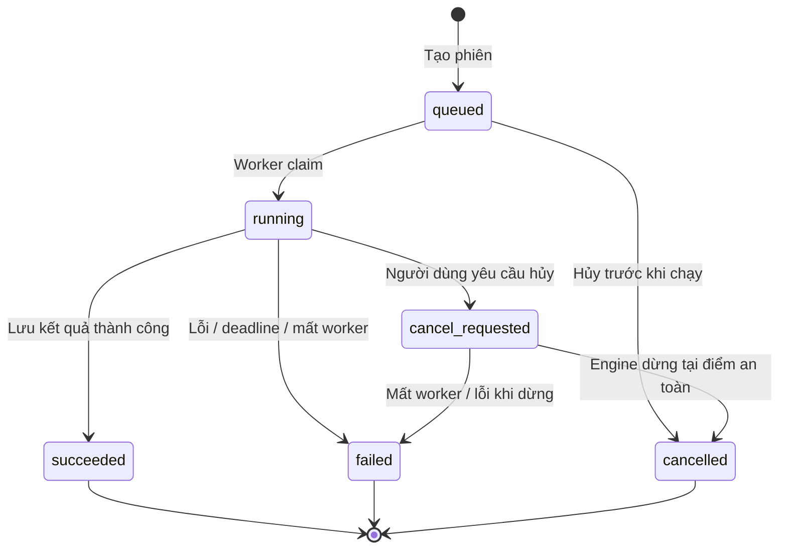

# Thiết kế backend

Yêu cầu và quy tắc nghiệp vụ được quản lý tại [requirements.md](requirements.md). Các use case, lifecycle và cơ chế xử lý bên dưới là phương án thực hiện để đối chiếu với mã FR/NFR/BR.

## 1. Kiến trúc module

Backend là một ứng dụng Python chia module theo nghiệp vụ. API và worker dùng chung domain/service/repository; lõi TradingAgents nằm sau một interface.

```text
backend/
  app/
    main.py                     # Khởi tạo FastAPI, router và middleware
    config.py                   # Cấu hình server; không trả secret cho FE
    api/
      dependencies.py           # Session, quyền và DB session
      routes/                   # auth, instruments, profiles, analyses, reports
      schemas/                  # Request/response và lỗi công khai
    modules/
      auth/                     # User, session, password, CSRF
      catalog/                  # Instrument và analysis profile
      analysis/                 # Use case, lifecycle, idempotency
      reporting/                # Báo cáo và decision view
    engines/
      base.py                   # AnalysisEngine interface
      mock.py                   # Engine giả lập có kịch bản
      tradingagents_adapter.py  # Chuyển input/output của lõi hiện có
    infrastructure/
      database/                 # SQLAlchemy models, repository, session
      storage/                  # Đường dẫn nội bộ theo run_id
    worker/
      main.py                   # Vòng claim tác vụ
      executor.py               # Chạy engine, deadline, hủy
      heartbeat.py              # Gia hạn lease bằng session riêng
      recovery.py               # Phát hiện lease hết hạn
  migrations/                   # Alembic
  tests/
```

Router chỉ xác thực input, gọi use case và map response. Service chứa quy tắc nghiệp vụ. Repository thực hiện truy vấn/transaction. Engine adapter không import router hoặc HTTP schema.

## 2. Các use case

| Use case | Trách nhiệm |
|---|---|
| `CreateAnalysis` | Quyền, profile, input, hạn mức, chống trùng, tạo phiên và các bước |
| `GetAnalysis` / `ListAnalyses` | Snapshot và lịch sử theo chủ sở hữu |
| `CancelAnalysis` | Chuyển trạng thái hủy theo lifecycle |
| `RetryAnalysis` | Tạo phiên mới từ input/config snapshot của phiên cũ |
| `ReadReports` / `ReadEvents` | Kiểm tra quyền trên phiên cha trước khi đọc |
| `ClaimAnalysis` | Nhận việc một cách nguyên tử |
| `PublishProgress` | Ghi báo cáo/bước/sự kiện với claim token hợp lệ |
| `CompleteAnalysis` | Ghi kết luận và terminal state trong cùng transaction |

## 3. Vòng đời phiên



`queued`, `running`, `cancel_requested` là trạng thái hoạt động. `succeeded`, `failed`, `cancelled` là terminal và không chuyển ngược.

`succeeded` biểu thị engine đã kết thúc và kết quả được lưu. Chất lượng kết luận nằm trong `decision.quality`: `valid` hoặc `needs_review`. Không suy ra khuyến nghị từ tên trạng thái.

Thử lại tạo một phiên `queued` mới, có `retry_of_run_id`; cấu hình phiên cũ giữ nguyên. MVP thử lại từ đầu, chưa cung cấp nút resume checkpoint cho người dùng.

## 4. Transaction tạo phiên và chống trùng

Trong một transaction:

1. Khóa hàng user để tuần tự hóa việc kiểm tra hạn mức theo người dùng.
2. Kiểm tra `Idempotency-Key` còn hiệu lực của user. Cùng request hash thì trả lại resource cũ; khác hash thì trả `409`.
3. Kiểm tra instrument, profile, khả năng hỗ trợ, ngày, ngôn ngữ và sự tương thích `data_mode`; không trộn catalog mock với profile live.
4. Kiểm tra số phiên hoạt động của user.
5. Lưu input snapshot và bản cấu hình server đã resolve; không lưu API key vào snapshot.
6. Tạo `analysis_runs` trạng thái `queued`, các bước ban đầu, `run.queued` và bản ghi idempotency.
7. Commit rồi trả `202`.

Phiên `queued` chính là công việc chờ trong PostgreSQL, nên không có khoảng hở giữa commit và gửi việc sang một broker khác. Request hash bao gồm method, đường dẫn và body đã chuẩn hóa; danh tính user được lấy từ session. Nếu bản ghi key đã hết hạn, thay thế nó trong cùng transaction đã khóa user; không để unique constraint biến ý định hợp lệ thành lỗi 500.

## 5. Worker và quyền sở hữu tác vụ

### Claim

Worker mở transaction ngắn: chọn phiên `queued` cũ nhất theo `(created_at, id)` bằng `FOR UPDATE SKIP LOCKED`, chuyển sang `running`, gán `worker_id`, `claim_token` ngẫu nhiên, `started_at`, `lease_expires_at`, ghi `run.started`, rồi commit. Không giữ transaction trong lúc gọi LLM hoặc vendor.

Mỗi worker process chạy tối đa một phiên; có thể chạy thêm process sau khi kiểm thử tải. Mỗi phiên có engine instance riêng. Một phiên không được chạy hai lần chỉ vì nhiều worker cùng đọc hàng đợi.

### Lease và heartbeat

- Heartbeat chạy mỗi 10 giây bằng một DB session riêng, gia hạn lease 60 giây.
- Heartbeat và mọi lần ghi tiến độ phải khớp `run_id`, `claim_token`, lease chưa hết hạn và trạng thái được phép.
- Worker mất claim phải dừng executor; kết quả từ worker cũ không được ghi vào DB.
- Recovery scan các phiên hoạt động có lease hết hạn và chuyển sang `failed` với mã `WORKER_LOST` bằng transaction có điều kiện.
- Phiên mất worker không tự quay lại `queued`. Người dùng chủ động thử lại để tránh phát sinh thêm lần gọi mô hình ngoài ý muốn.

Recovery chạy ở đầu mỗi vòng worker và trong một nhịp định kỳ của worker supervisor khi đang có tác vụ. Khi toàn bộ worker ngừng, API vẫn nhận yêu cầu vào hàng đợi; sau khi worker khởi động lại, recovery xử lý các lease cũ trước khi claim việc mới.

### Deadline và hủy

Executor chạy engine trong process con có giám sát để supervisor có thể cưỡng chế kết thúc khi vượt deadline. Process con gửi progress/result qua IPC; supervisor giữ claim và thực hiện các lần ghi DB, process con không dùng lại DB connection của cha. API chỉ thay đổi trạng thái trong DB. Worker kiểm tra hủy giữa các bước và các lần gọi công cụ; request đã gửi tới provider có thể còn chạy đến khi trả về hoặc timeout.

- Hủy `queued`: chuyển ngay sang `cancelled`.
- Hủy `running`: chuyển sang `cancel_requested`, chờ worker dừng.
- Khi worker xác nhận dừng: chuyển `cancelled`; giữ các báo cáo hoàn thành trước đó.
- Kết thúc và hủy tranh chấp: khóa hàng run. Nếu yêu cầu hủy đã được commit trước, không publish quyết định cuối; nếu thành công đã commit, API hủy trả `409`.
- Khi quá thời gian: chấm dứt process con, chuyển `failed` với `RUN_TIMEOUT` nếu vẫn giữ claim. Shutdown supervisor phải dọn process con; không chỉ đóng vòng polling.

## 6. Interface với engine

```text
AnalysisInput
  run_id, instrument_snapshot, as_of_date
  profile_snapshot, language, execution_config

AnalysisEngine
  describe_steps(input) -> ordered StepDefinition[]
  execute(input, publish, cancellation) -> EngineResult

EngineResult
  reports[]
  decision: quality, rating?, summary_markdown, warnings[]
  metadata: engine_name, engine_version?, data_mode
```

`publish` chỉ nhận các sự kiện có schema, ví dụ `step.started`, `step.completed`, `report.ready`. Payload công khai không chứa secret, prompt hay raw stack trace. Callback ghi sự kiện phải qua service có kiểm tra claim.

`describe_steps` là thao tác metadata không gọi provider hay khởi chạy graph, cung cấp tiến độ ở mức ổn định: chuẩn bị, phân tích, tổng hợp và hoàn tất. Adapter có thể bổ sung bước chi tiết; FE hiển thị danh sách từ server. Không cần thay graph nội bộ để dựng giao diện ban đầu.

Mock engine hỗ trợ các kịch bản: thành công, cần xem xét, thất bại giữa chừng, chạy chậm, hủy, mất worker. Công cụ cấu hình kịch bản chỉ bật trong development/test, không xuất hiện trong form người dùng triển khai thật.

## 7. Tích hợp TradingAgents

| Điểm trong code | Cách dùng dự kiến |
|---|---|
| `TradingAgentsGraph` | Tạo instance riêng bằng deep copy cấu hình đã resolve |
| `create_run_state()` | Giữ khởi tạo identity/context theo luồng lõi |
| `checkpoint_scope()` và `graph.stream()` | Chạy có checkpoint và đọc tiến độ trong scope `run_config` |
| `record_decision()` và `save_reports()` | Lưu kết quả theo không gian riêng của phiên |
| `rating.parse_rating()` | Map giá trị khuyến nghị; `REVIEW` thành `quality = needs_review`, `rating = null` |

Adapter dùng thư mục `runs/{run_id}/` cho `results_dir`, `data_cache_dir` và `memory_log_path`; checkpoint theo ticker bên trong thư mục này vẫn được cô lập theo run. Bộ nhớ liên phiên chưa được chia sẻ trong MVP.

Không copy cơ chế monkey-patch hiển thị terminal của `cli/run.py`. Adapter chuyển stream/callback thành sự kiện nghiệp vụ và chịu trách nhiệm hoàn tất các bước ghi log mà luồng streaming cần. Mọi helper có side effect phải được kiểm chứng khi viết adapter.

Output hiện tại chủ yếu là Markdown. Adapter chỉ cung cấp các trường đã xác định được; không tự bịa giá, xác suất hoặc nguồn dẫn. Việc lưu object structured đầy đủ có thể được bổ sung khi hợp đồng engine được mở rộng.

## 8. Báo cáo và tính nhất quán

- Khi có báo cáo: cập nhật `reports`, đánh dấu bước nếu cần, tăng run version và thêm sự kiện trong cùng transaction.
- Sự kiện có `seq` tăng trong từng run, được cấp bằng cách khóa hàng run.
- Snapshot chứa bước, metadata báo cáo, quality và `event_cursor`; nội dung báo cáo đầy đủ được đọc riêng.
- Khi hoàn tất: lưu decision, các phần báo cáo cuối, trạng thái `succeeded`, `finished_at` và `run.succeeded` cùng transaction.
- API không phục vụ trực tiếp file qua đường dẫn browser cung cấp. File nội bộ là artifact; PostgreSQL giữ kết quả dùng cho giao diện.

## 9. Xác thực, cấu hình và vận hành

- Password được hash bằng thuật toán dành cho mật khẩu, đề xuất Argon2id; tài khoản được tạo bởi lệnh quản trị ban đầu.
- Session token ngẫu nhiên chỉ nằm trong cookie; DB lưu token hash. Cookie production: HttpOnly, Secure, SameSite=Lax, Path=/api.
- Login kiểm tra Origin/Referer cùng origin, rate limit và đổi session token sau đăng nhập. Mutation có session yêu cầu `X-CSRF-Token`.
- Session hết hạn tuyệt đối sau 8 giờ; logout thu hồi server-side. Mỗi API dữ liệu kiểm tra owner.
- Secret đọc từ môi trường server. Profile công khai chỉ có mô tả và capability; người dùng không gửi provider URL, đường dẫn hoặc model ID tùy ý.
- SQLAlchemy Session có scope riêng cho request, heartbeat và tác vụ; không dùng chung session giữa các thread/process.
- Log có `request_id`, `run_id`, `worker_id`; lưu stack trace nội bộ và trả mã lỗi hữu ích cho người dùng.
- Health tách liveness và readiness; readiness kiểm tra DB. Trạng thái worker được giám sát qua heartbeat để nhận biết hàng đợi đang bị ùn.

## 10. Các lỗi cần đặc tả

| Lỗi | Trạng thái / hành vi |
|---|---|
| Input hoặc profile không hỗ trợ | `422`, chưa tạo run |
| Vượt giới hạn phiên | `429`, chưa tạo run |
| Lỗi gọi provider sau retry có giới hạn | `failed`, lưu mã `ENGINE_UNAVAILABLE` hoặc lỗi domain cụ thể |
| Có kết luận nhưng rating không đọc được | `succeeded` + `needs_review` |
| Không có kết quả cuối do engine hỏng | `failed`, báo cáo đã hoàn thành vẫn đọc được |
| DB lỗi lúc ghi kết quả | Không công bố thành công; retry ghi có giới hạn trong lease; quá hạn thì recovery đánh dấu mất worker |
| Worker chết hoặc heartbeat hết hạn | `failed` + `WORKER_LOST` |
| Engine vượt thời gian cho phép | `failed` + `RUN_TIMEOUT` |

MVP không tự retry toàn bộ một phiên. Retry từng request tới provider thuộc cấu hình engine; số lần thử phải hữu hạn và nằm trong deadline của phiên.
