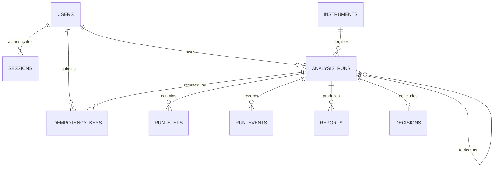

# Mô hình dữ liệu

Các yêu cầu và quy tắc nghiệp vụ cần được dữ liệu bảo đảm được quản lý tại [requirements.md](../requirements.md), đặc biệt là quyền sở hữu, lifecycle, idempotency và tính nhất quán.

ERD và bảng dưới đây thuộc MVP1. Các bảng watchlist/quote/OHLCV và trường quote_context được lưu tại [backlog sau MVP1](../planning/post-mvp-market-workspace.md); chưa cần migration cho chúng trong MVP1.

MVP1 phải lưu được instrument/profile live, input/config snapshot, tiến độ, báo cáo và kết luận từ lõi TradingAgents với dữ liệu thật. Catalog mock phục vụ phát triển/CI; trước nghiệm thu mốc 5 phải có ít nhất một instrument/profile live đã xác nhận hỗ trợ. Việc chưa có bảng quote/OHLCV phục vụ bảng điện không ngăn lõi lấy dữ liệu phân tích từ nguồn thật qua công cụ của engine.

## 1. Nguyên tắc

PostgreSQL lưu dữ liệu ứng dụng. SQLAlchemy model và Alembic migration được xây từ mô hình dưới đây. UUID là khóa công khai; timestamp dùng `timestamptz` và UTC. Ngày nghiệp vụ dùng `date`.

Kết quả cũ sử dụng instrument/profile snapshot của phiên, nên việc cập nhật catalog không làm thay đổi báo cáo lịch sử. Snapshot chứa cấu hình có thể công khai hoặc cần cho thực thi, đã loại bỏ secret.

## 2. ERD

Analysis profile ban đầu là cấu hình có version trong backend, chưa cần bảng quản trị profile. Mỗi run lưu bản resolved snapshot để có thể kiểm tra hoặc thử lại.

## 3. Các bảng

### `users`

| Trường | Kiểu / ràng buộc |
|---|---|
| `id` | UUID PK |
| `email_normalized` | Text unique, lowercase theo quy tắc tài khoản |
| `display_name` | Text |
| `password_hash` | Text |
| `is_active` | Boolean |
| `created_at`, `updated_at` | Timestamptz |

### `sessions`

| Trường | Kiểu / ràng buộc |
|---|---|
| `id` | UUID PK |
| `user_id` | FK users |
| `token_hash` | Text unique; hash token cookie |
| `csrf_token_hash` | Text; đối chiếu token mutation |
| `expires_at`, `created_at` | Timestamptz |
| `revoked_at` | Timestamptz nullable |

Session hợp lệ khi user hoạt động, chưa bị thu hồi và chưa hết hạn. Token/CSRF token thô không được ghi vào log. Token CSRF được dẫn xuất bằng HMAC từ session token và một khóa server riêng, có phân tách ngữ cảnh `csrf`; DB lưu hash để kiểm tra. API đọc cookie hợp lệ để trả lại cùng CSRF token qua session response, tránh vô hiệu hóa token của tab khác. Logout thu hồi session nên đồng thời vô hiệu hóa CSRF token.

### `instruments`

| Trường | Kiểu / ràng buộc |
|---|---|
| `id` | UUID PK |
| `symbol`, `exchange` | Text; unique cùng `asset_type` |
| `name`, `asset_type` | Text |
| `currency`, `timezone` | Text; timezone IANA |
| `provider_reference` | JSONB; định danh đã cấu hình phía server |
| `capabilities` | JSONB; profile, ngôn ngữ, giới hạn ngày |
| `data_mode` | `mock` hoặc `live` |
| `is_enabled` | Boolean |
| `created_at`, `updated_at` | Timestamptz |

Giới hạn ngày thực tế được backend tính lại từ capability và thời gian hiện tại khi trả catalog. Không hard-code ngày mới nhất trong dữ liệu seed live.

### `analysis_runs`

| Trường | Kiểu / ràng buộc |
|---|---|
| `id` | UUID PK |
| `owner_id` | FK users |
| `instrument_id` | FK instruments |
| `instrument_snapshot` | JSONB; mã, tên, sàn, timezone và mapping cần thiết |
| `as_of_date` | Date |
| `profile_id`, `profile_version`, `language` | Text |
| `profile_snapshot` | JSONB; cấu hình đã resolve, không có secret |
| `engine_name`, `engine_version` | Text; version có thể nullable nếu engine không cung cấp |
| `data_mode` | `mock` hoặc `live` |
| `status` | Enum lifecycle |
| `current_step_key` | Text nullable |
| `version` | Bigint, tăng theo cập nhật nghiệp vụ |
| `last_event_seq` | Bigint, seq cuối đã cấp |
| `retry_of_run_id` | FK analysis_runs nullable, cùng owner |
| `worker_id`, `claim_token` | Text / UUID nullable |
| `lease_expires_at`, `heartbeat_at` | Timestamptz nullable |
| `error_code`, `error_message` | Text nullable, thông báo công khai |
| `created_at`, `started_at`, `finished_at` | Timestamptz; hai trường cuối nullable |

Input/config snapshot bất biến sau khi tạo. Chỉ trạng thái, tiến độ, lease và thông tin kết thúc được thay đổi.

### `run_steps`

| Trường | Kiểu / ràng buộc |
|---|---|
| `id` | UUID PK |
| `run_id` | FK analysis_runs |
| `step_key` | Text; unique cùng run_id |
| `label`, `sort_order` | Text / Integer |
| `status` | `pending`, `running`, `completed`, `failed`, `skipped` |
| `started_at`, `finished_at` | Timestamptz nullable |
| `reason_code` | Text nullable, ví dụ `CANCELLED` |

Bước ở mức giai đoạn nên ổn định; các lượt nội bộ lặp lại được ghi thành event. Trước khi chuyển terminal, bước chưa bắt đầu được chuyển `skipped`; bước đang chạy thành `failed` khi có lỗi hoặc `skipped` với lý do hủy. Bước đã hoàn thành được giữ nguyên.

### `run_events`

| Trường | Kiểu / ràng buộc |
|---|---|
| `run_id`, `seq` | Composite PK; FK run |
| `type` | Text theo event schema |
| `payload` | JSONB đã lọc thông tin |
| `occurred_at` | Timestamptz |

Seq tăng theo thứ tự commit trong từng run. Không cần seq liên tục giữa các run. API luôn đọc theo `run_id` và `seq > after`.

### `reports`

| Trường | Kiểu / ràng buộc |
|---|---|
| `id` | UUID PK |
| `run_id` | FK analysis_runs |
| `section_key` | Text; unique cùng run_id |
| `title`, `content_markdown` | Text |
| `revision` | Integer >= 1; tăng khi title/nội dung thay đổi |
| `created_at`, `updated_at` | Timestamptz |

Một section giữ report ID ổn định và bản nội dung mới nhất. Khi title/nội dung thay đổi, tăng revision, updated_at và run version, ghi report.ready trong cùng transaction. Nếu engine lặp lại báo cáo không đổi, không tăng revision hoặc ghi event trùng. Data mode lấy từ run cha, không cho client ghi đè.

### `decisions`

| Trường | Kiểu / ràng buộc |
|---|---|
| `run_id` | PK và FK analysis_runs |
| `quality` | `valid` hoặc `needs_review` |
| `rating` | Một trong năm rating, hoặc null |
| `summary_markdown` | Text |
| `warnings` | JSONB array `{code, message}` |
| `created_at` | Timestamptz |

SQL CHECK: `quality = valid` yêu cầu rating thuộc năm giá trị; `quality = needs_review` yêu cầu `rating IS NULL`.

Khi viết CHECK cho nhánh valid phải có `rating IS NOT NULL` ngoài phép kiểm tra IN; PostgreSQL không coi kết quả CHECK là NULL là một vi phạm. Như vậy quality=valid không thể lọt qua với rating rỗng.

### `idempotency_keys`

| Trường | Kiểu / ràng buộc |
|---|---|
| `owner_id`, `key` | Composite PK; owner FK users, key UUID |
| `request_hash` | Text; hash method + path + body chuẩn hóa |
| `run_id` | FK analysis_runs, cùng owner |
| `response_status`, `response_body`, `response_location` | Integer / JSONB / Text |
| `created_at`, `expires_at` | Timestamptz, thời hạn mặc định 24 giờ |

Retry endpoint dùng cùng bảng, có path khác trong request hash. Dùng composite FK `(owner_id, run_id)` tới unique `(owner_id, id)` của run để ràng buộc cùng chủ sở hữu. `retry_of_run_id` áp dụng ràng buộc owner tương tự.

## 4. Index và constraint

- `analysis_runs(owner_id, created_at DESC, id DESC)` cho lịch sử và cursor.
- Tìm q theo symbol/name trong instrument_snapshot của run sau khi lọc owner; không đọc tên catalog mới để ghi đè tên lịch sử. Chỉ bổ sung index tìm kiếm khi query plan cho thấy cần.
- Index thêm theo owner/status khi số bản ghi cần; kiểm tra bằng query plan trước khi bổ sung nhiều index.
- Partial index `analysis_runs(created_at, id) WHERE status = 'queued'` cho worker claim.
- Partial index `analysis_runs(lease_expires_at) WHERE status IN ('running', 'cancel_requested')` cho recovery.
- Unique `(run_id, step_key)` và `(run_id, section_key)`; index FK trên các bảng con.
- Terminal state yêu cầu `finished_at IS NOT NULL`; trạng thái hoạt động yêu cầu `finished_at IS NULL`.
- `running/cancel_requested` có claim token và lease; `queued/terminal` không có claim token hay lease.
- `version >= 1`, `last_event_seq >= 1` sau khi tạo phiên.
- Các quan hệ cùng owner phải được kiểm tra ở service và ràng buộc tại DB khi mô hình cho phép.

Invariant “run succeeded phải có decision” được đảm bảo bằng transaction hoàn tất và integration test, vì CHECK đơn giản không truy vấn được bảng khác.

## 5. Transaction quan trọng

| Thao tác | Nội dung nguyên tử |
|---|---|
| Tạo phiên | Khóa user, kiểm tra idempotency/hạn mức, insert run/steps/event/key |
| Thử lại | Kiểm tra owner nguồn, khóa user, replay key trước capability/quota; nếu chưa có key thì tạo run/steps/event/key từ snapshot nguồn, resolve storage theo ID mới |
| Claim | Khóa run queued bằng SKIP LOCKED, gán claim và lease, ghi started |
| Progress | Khóa run, kiểm tra claim/lease/state, cập nhật step/report và report revision nếu thay đổi, tăng version/seq, append event |
| Heartbeat | UPDATE có điều kiện theo claim/lease/state; không tăng version |
| Hủy | Khóa run, đổi trạng thái, tăng version/seq, append event |
| Hoàn tất | Kiểm tra claim và hủy, lưu báo cáo cuối/decision, đổi terminal, xóa lease/claim, append event |
| Xác nhận hủy sau kết quả engine | Sau khi process con đã thoát: khóa run, kiểm tra claim/lease/cancel_requested, bỏ kết quả cuối chưa publish, giữ report đã commit, cập nhật steps/finished_at/current_step_key, xóa claim/lease, tăng version/seq và append một run.cancelled; không insert decision |
| Recovery | Khóa run lease hết hạn, đánh dấu failed, dọn claim/lease, cập nhật steps và event |

Không mở transaction trong suốt thời gian chạy engine. Nếu UPDATE có điều kiện không còn khớp, worker mất quyền ghi và phải dừng. Server đọc snapshot chi tiết bằng read-only REPEATABLE READ hoặc một truy vấn tương đương để giữ dữ liệu nhất quán.

## 6. Artifact và retention

Artifact nằm dưới một storage root do server kiểm soát, theo `runs/{run_id}/`. UUID được backend sinh; ticker hoặc đường dẫn browser gửi không được dùng làm đường dẫn gốc.

File checkpoint và memory là dữ liệu thực thi của từng phiên, khác với tài liệu thiết kế trong `docs/`. API đọc báo cáo từ DB; việc xóa artifact đã hết thời gian giữ không làm mất nội dung báo cáo đã lưu.

MVP không có API xóa lịch sử. Job bảo trì dọn session/idempotency hết hạn và artifact tạm của phiên terminal. Thời gian giữ báo cáo và chính sách xóa tài khoản cần được nhóm chốt trước khi có người dùng ngoài nhóm; chưa tự động xóa dữ liệu nghiệp vụ.
