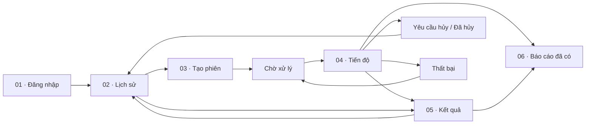
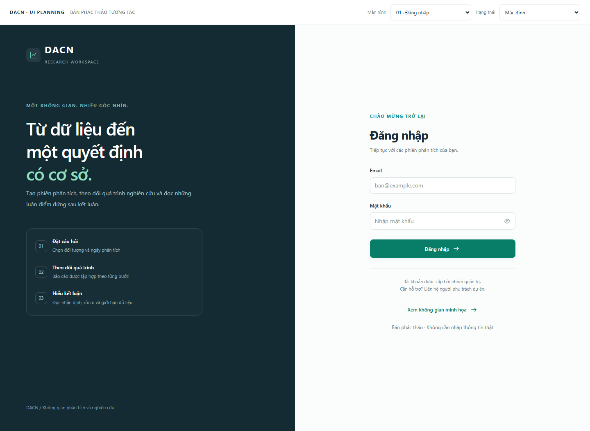
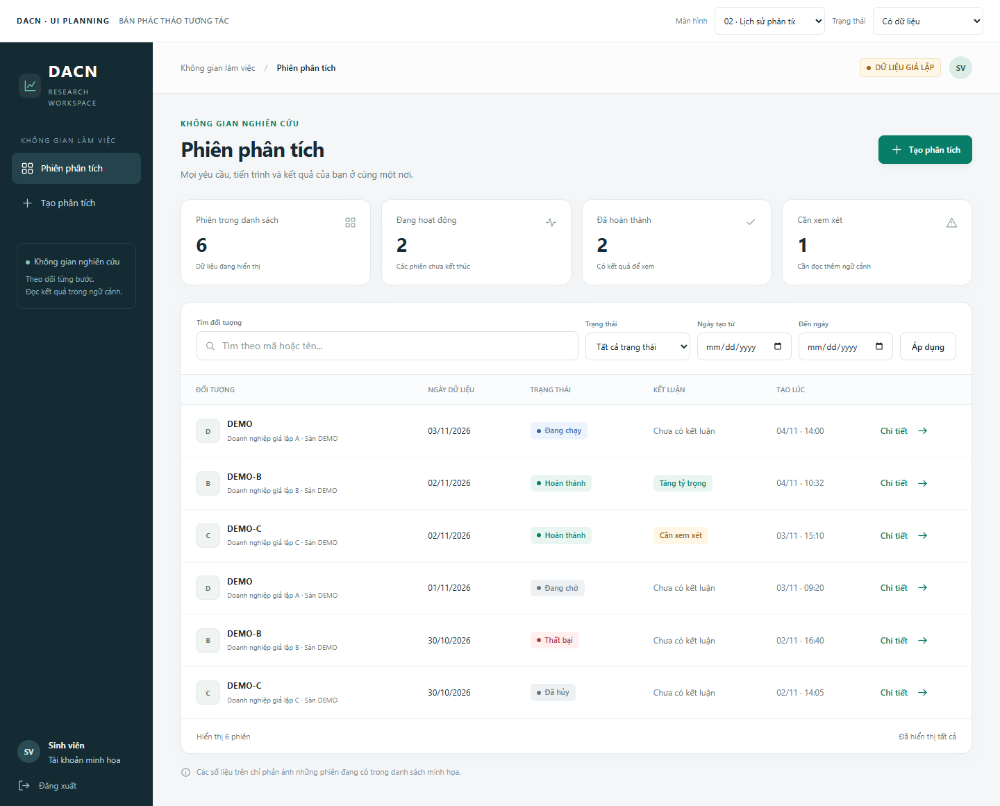
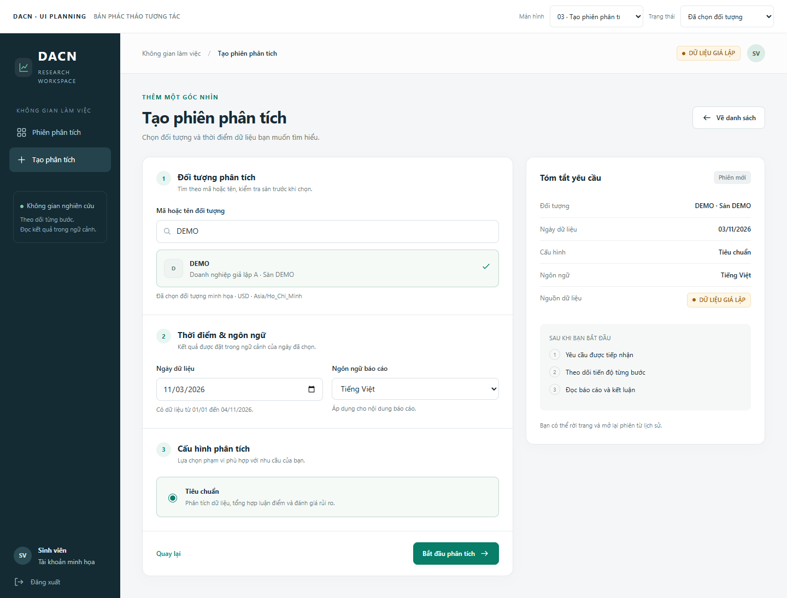
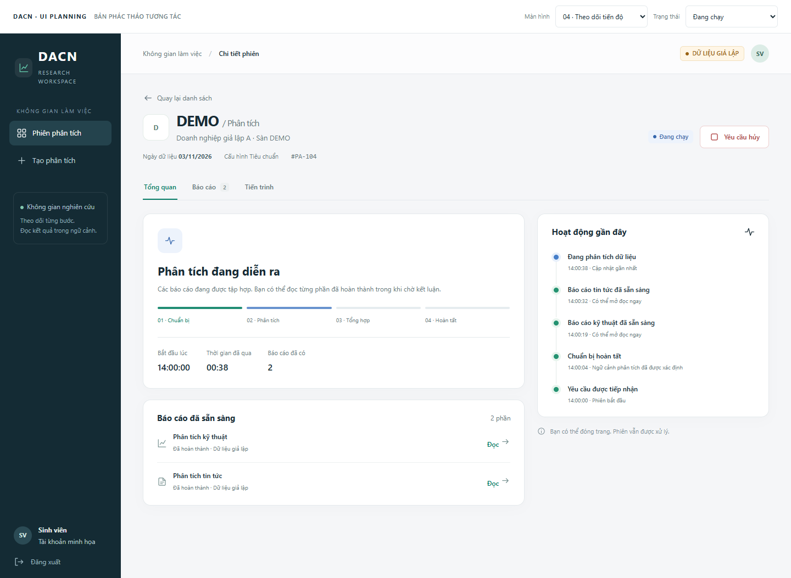
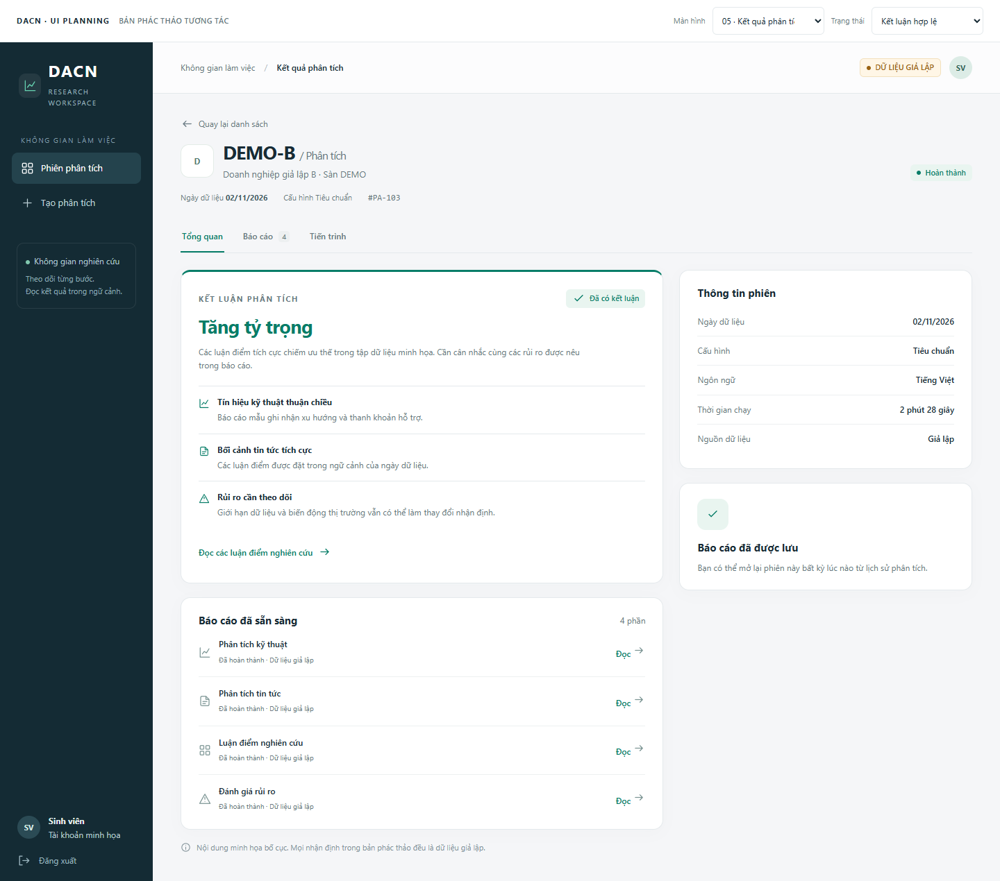
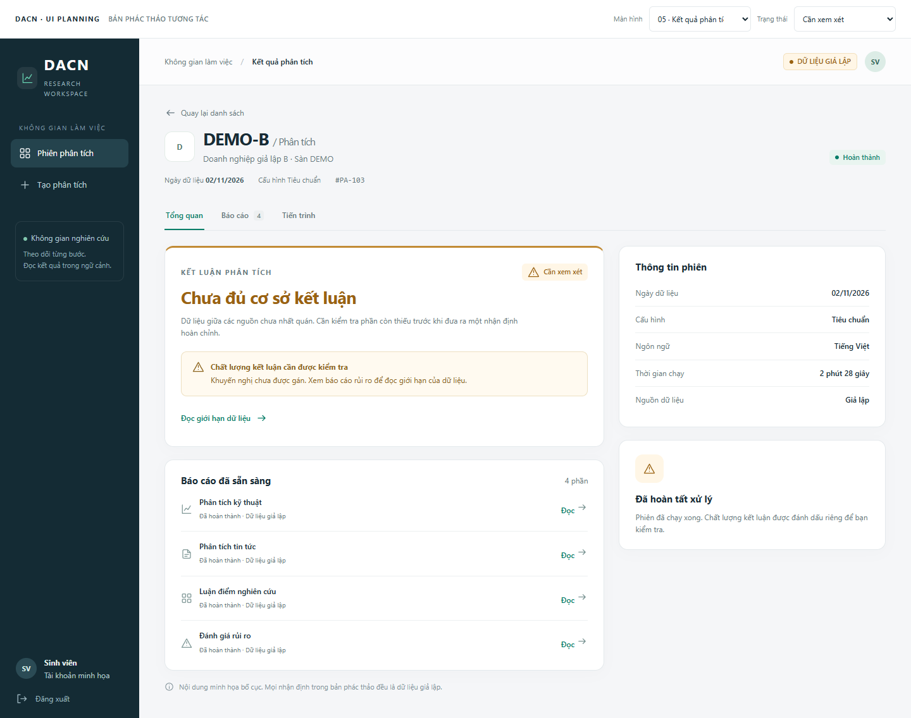
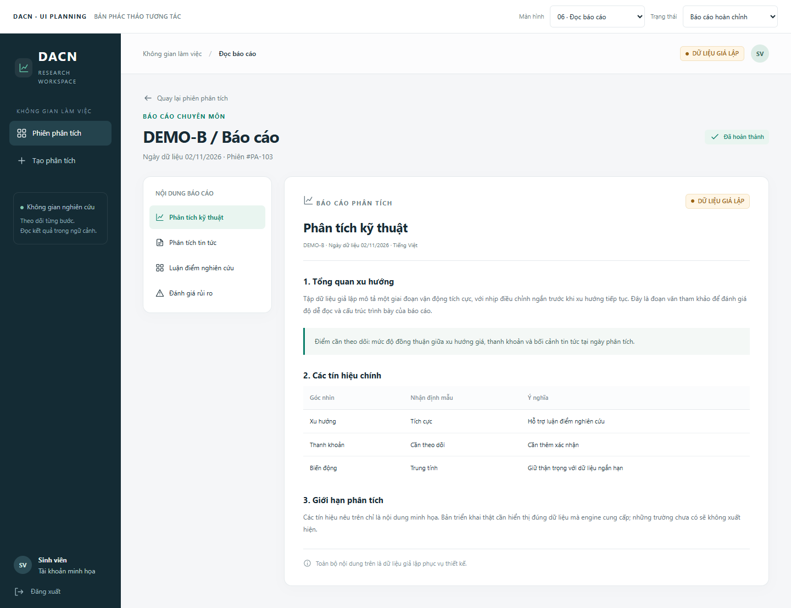
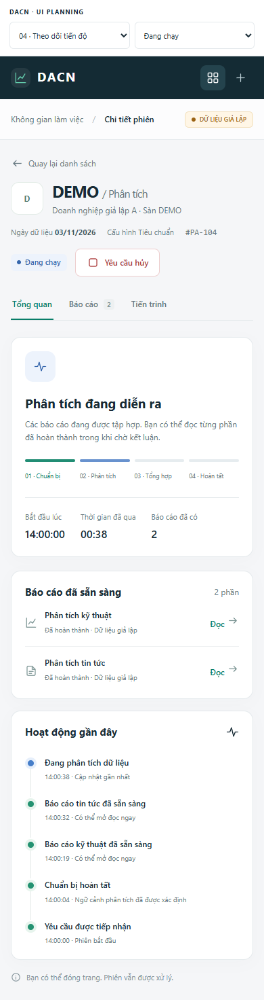

# Planning giao diện frontend

Các màn hình và prototype trong tài liệu này là tham khảo bố cục cho MVP1 quản lý phiên phân tích. Ứng dụng MVP1 phải kết nối lõi TradingAgents qua backend để lấy dữ liệu thật, hiển thị tiến độ và báo cáo/kết luận; prototype giả lập không phải bằng chứng nghiệm thu. [Bảng điện theo dõi giá và watchlist](../planning/post-mvp-market-workspace.md) được triển khai ở giai đoạn tiếp theo sau nghiệm thu MVP1.

## 1. Cách xem bản phác thảo

Mở [prototype.html](prototype.html) bằng trình duyệt để thử các màn hình. File hoạt động độc lập khi mở trực tiếp, không cần chạy backend hay cài frontend. Nếu xem trên GitHub, tải file HTML về để mở; GitHub chỉ hiển thị mã nguồn của HTML.

Thanh **UI Planning** ở đầu trang dùng để chọn màn hình và trạng thái mẫu. Đây là công cụ xem thiết kế, không thuộc giao diện sản phẩm. Các ảnh bên dưới được chụp từ cùng file HTML.

Phạm vi: sáu màn hình chính, phiên bản mobile của màn hình theo dõi và các trạng thái phụ. Dữ liệu, mã đối tượng, tài khoản và nhận định đều là giả lập; ngày minh họa cố định ở 04/11/2026. Prototype không gửi request, xác thực thật hoặc lưu mật khẩu. Tương tác trong phiên xem không tồn tại sau khi tải lại trang.

Prototype dùng ID ngắn và fixture trình bày riêng, không phải mock API tuân thủ OpenAPI. UUID/schema, session, idempotency, quota, polling và lease được kiểm chứng ở ứng dụng thực hiện theo contract; không suy ra chúng đã đạt từ việc bấm thử HTML. Thanh chọn màn hình/trạng thái chỉ đổi kịch bản xem, không khởi chạy engine.

Khi xây React, nhãn chế độ dữ liệu và nội dung phải lấy từ API: `mock` hiển thị “Dữ liệu giả lập”, `live` hiển thị “Dữ liệu nguồn thực”. Các ảnh hiện tại vẫn minh họa fixture; TC-13 ở mốc 5 trong MVP1 phải có bằng chứng ứng dụng chạy với lõi/provider thật và mở lại kết quả từ lịch sử.

## 2. Hướng hình ảnh

Phong cách đề xuất là một không gian nghiên cứu gọn, dễ đọc: nền sáng, sidebar xanh đậm, nội dung trên card trắng, màu xanh lục làm điểm nhấn cho hành động chính. Trạng thái xử lý và chất lượng kết luận có nhãn riêng.

| Thành phần | Quy ước đề xuất |
|---|---|
| Nền trang | `#F5F6F8` |
| Card | `#FFFFFF`, viền `#E4E9EC`, góc bo 14 px |
| Sidebar | `#142B34` |
| Chữ chính / phụ | `#182B35` / `#677881` |
| Hành động chính | `#087D68` |
| Đang chạy | Xanh dương, có nhãn chữ |
| Cần xem xét / yêu cầu hủy | Vàng nâu, có nhãn chữ |
| Thất bại | Đỏ, có mô tả và cách xử lý |
| Typography | Segoe UI hoặc system font hỗ trợ tiếng Việt |
| Cỡ chữ | Tiêu đề 24–30 px; nội dung 13–14 px; metadata 11–12 px |
| Khoảng cách | Nhịp 4/8 px, card cách nhau 16–24 px |

Sidebar desktop rộng khoảng 220 px, gồm tên ứng dụng, danh sách phiên, tạo phân tích và tài khoản. Nội dung có bề rộng tối đa để báo cáo không bị trải quá dài. Mobile thay sidebar bằng thanh điều hướng gọn ở trên.

Mỗi màn hình có một hành động chính rõ ràng. Những trường phục vụ cấu hình hạ tầng, mô hình và secret thuộc backend; giao diện người dùng tập trung vào yêu cầu phân tích.

## 3. Luồng tham khảo

Tiến độ và kết quả dùng cùng route chi tiết phiên. Trong bản HTML, hai màn hình được tách để dễ so sánh bố cục; ứng dụng thật chọn cách hiển thị từ trạng thái API.

## 4. Màn hình 01 — Đăng nhập

**Mục tiêu:** giúp người dùng vào không gian làm việc với một form ngắn.

- Desktop chia hai phần: giới thiệu quy trình bên trái, form bên phải.
- Form có email, mật khẩu, hiện/ẩn mật khẩu và nút đăng nhập.
- Thông tin hỗ trợ nằm dưới form; tài khoản được cấp trước theo phạm vi MVP.
- Lỗi đăng nhập hiển thị trong form và dùng thông báo chung.
- Mobile giữ form làm trọng tâm và thu gọn phần giới thiệu.

Nút “Xem không gian minh họa” chỉ dùng trong prototype. Khi hiện thực hóa, đăng nhập gọi `POST /auth/login`; không đưa nút này vào luồng xác thực thật.

## 5. Màn hình 02 — Danh sách và lịch sử phân tích

**Mục tiêu:** biết đang có phiên nào hoạt động và mở nhanh kết quả cũ.

| Vùng | Nội dung | Tương tác |
|---|---|---|
| Đầu trang | Tiêu đề, mô tả và “Tạo phân tích” | Mở form mới |
| Thẻ tổng hợp | Số phiên, đang hoạt động, đã hoàn thành, cần xem xét | Chỉ tổng hợp các dòng trong danh sách mẫu |
| Bộ lọc | Mã/tên, trạng thái, khoảng ngày tạo | Tìm/lọc; giữ điều kiện khi triển khai route thật |
| Danh sách | Đối tượng, ngày dữ liệu, trạng thái, kết luận, thời gian tạo | Mở chi tiết đúng phiên |
| Cuối danh sách | Số dòng, điều hướng phân trang khi có | Theo cursor từ API |

Trong MVP, có thể giữ hoặc lược bỏ các thẻ tổng hợp. Nếu giữ, nhãn phải chỉ rõ phạm vi dữ liệu đang tải; API hiện tại chưa có endpoint thống kê toàn bộ tài khoản.

Trạng thái “Hoàn thành” nằm ở cột xử lý; “Cần xem xét” nằm ở cột kết luận. Một phiên có thể mang cả hai nhãn mà không mâu thuẫn.

Trong prototype, tìm mã và bộ lọc trạng thái/ngày có thể dùng trực tiếp. Ứng dụng thật gửi q và các filter cùng request lịch sử, tính ngày theo timezone hiển thị. Chọn “Chưa có phiên” hoặc “Mất kết nối” trên thanh Planning để xem trạng thái phụ.

## 6. Màn hình 03 — Tạo phiên phân tích

**Mục tiêu:** biến một yêu cầu phân tích thành thao tác nhập liệu rõ ràng, có thể kiểm tra trước khi gửi.

- Bên trái là form chia ba nhóm: đối tượng, thời điểm/ngôn ngữ và cấu hình.
- Kết quả chọn đối tượng luôn có tên và sàn cạnh mã.
- Bên phải tóm tắt yêu cầu: mã, ngày dữ liệu, profile, ngôn ngữ và nhãn giả lập.
- Nút “Bắt đầu phân tích” đặt ở cuối form; “Quay lại” là hành động phụ.
- Lỗi ngày dữ liệu nằm sát trường, form giữ input để người dùng sửa.

Trên mobile, bản tóm tắt được đưa lên trước form theo luồng một cột; có thể thu gọn ở bước triển khai nếu thử nghiệm cho thấy nó làm chậm việc nhập liệu.

Prototype hỗ trợ đối tượng `DEMO` và khoảng ngày cố định để xem validation. Ứng dụng thật lấy catalog, capability và giới hạn ngày từ API.

## 7. Màn hình 04 — Theo dõi phiên đang chạy

**Mục tiêu:** người dùng biết yêu cầu đã được tiếp nhận và có thể đọc kết quả từng phần.

| Vùng | Nội dung |
|---|---|
| Đầu trang | Đối tượng, ngày dữ liệu, profile, mã phiên, trạng thái và yêu cầu hủy |
| Tab | Tổng quan, Báo cáo và Tiến trình |
| Card tiến độ | Bước đang xử lý, giai đoạn hoàn thành, thời gian và số báo cáo |
| Báo cáo đã sẵn sàng | Chỉ mở các phần đã được lưu |
| Hoạt động gần đây | Các sự kiện nghiệp vụ theo thời gian |

Tiến độ thể hiện theo giai đoạn thay vì một tỷ lệ phần trăm chưa có cơ sở. Backend cung cấp tên và trạng thái bước; UI không tự suy ra rằng toàn bộ agent đã chạy chỉ từ thời gian đã qua.

Nút hủy mở dialog xác nhận. Với phiên đang chạy, xác nhận chuyển sang “Đang yêu cầu hủy”; với phiên đang chờ, có thể chuyển thẳng “Đã hủy”. Prototype cho đổi trạng thái bằng thanh Planning để quan sát, không tự giả lập tốc độ engine bằng bộ đếm chạy nền.

## 8. Màn hình 05 — Kết quả phân tích

**Mục tiêu:** đọc được kết luận trước, sau đó đi vào bằng chứng và rủi ro.

- Kết luận là vùng nổi bật nhất, có nhãn khuyến nghị và đoạn tóm tắt ngắn.
- Các phần luận điểm và rủi ro đặt ngay dưới tóm tắt.
- Báo cáo chi tiết luôn có đường dẫn đọc từ màn hình này.
- Thông tin phiên giữ ở cột phụ để người dùng kiểm tra ngữ cảnh.
- Nhãn giả lập xuất hiện rõ trên header và trong báo cáo.

Các bullet “tín hiệu kỹ thuật”, “tin tức” và “rủi ro” trong hình là ví dụ biên tập nội dung. API hiện tại cung cấp `summary_markdown`; frontend thật render nội dung đã có thay vì tự bóc tách hay phát sinh các bullet không được engine cung cấp. Nếu cần card có cấu trúc riêng, phải bổ sung schema qua bước chốt contract.

Không thêm phần trăm tin cậy, giá mục tiêu, biểu đồ thị giá hay P&L khi backend chưa có dữ liệu tương ứng.

### Khi kết luận cần xem xét

Phiên vẫn có trạng thái “Hoàn thành”; vùng kết luận đổi thành “Chưa đủ cơ sở kết luận”, cùng cảnh báo và liên kết đọc giới hạn dữ liệu. Ánh xạ từ API: `status = succeeded`, `decision.quality = needs_review`, `rating = null`.

## 9. Màn hình 06 — Đọc báo cáo

**Mục tiêu:** có đủ không gian đọc nội dung dài và chuyển giữa các phần.

- Mục lục bên trái chứa các phần thực sự được backend trả về.
- Bên phải là bài báo cáo: tiêu đề, đối tượng, ngày dữ liệu, ngôn ngữ và nội dung.
- Hỗ trợ heading, danh sách, bảng và trích đoạn nhấn mạnh.
- Nút quay lại giữ ngữ cảnh phiên.
- Trên mobile, mục lục chuyển thành dải chọn phần theo chiều ngang.

Màn hình này có thể triển khai bên trong tab “Báo cáo” của `/analyses/:id`, với report ID trong search params. Không cần tạo một hệ thống route độc lập hay endpoint mới.

## 10. Bố cục mobile

| Desktop | Mobile |
|---|---|
| Sidebar dọc | Thanh điều hướng trên cùng |
| Hai cột thông tin | Một cột, trạng thái và hành động ở phía trên |
| Lịch sử dạng bảng | Mỗi dòng chuyển thành card thông tin |
| Mục lục báo cáo bên trái | Dải chọn phần có thể cuộn ngang |
| Nút ở cạnh tiêu đề | Xuống hàng khi cần, giữ vùng chạm rõ ràng |

Mốc bố cục tham khảo: trên 900 px dùng sidebar, 601–900 px thu gọn điều hướng, tối đa 600 px dùng một cột. Kiểm tra ở 390 px và 1440 px trước khi bàn giao implementation.

## 11. Các trạng thái phụ cần giữ khi xây FE

| Trạng thái | Cách trình bày | Hành động phù hợp |
|---|---|---|
| Chưa có phiên | Empty state và lời hướng dẫn ngắn | Tạo phân tích |
| Không có kết quả lọc | Giữ bộ lọc và mô tả | Xóa/đổi bộ lọc |
| Đang chờ | Thông báo đã nhận yêu cầu; chưa có báo cáo | Hủy hoặc quay lại lịch sử |
| Mất kết nối | Giữ dữ liệu gần nhất, banner kết nối | Kết nối lại |
| Lỗi input | Thông báo tại trường | Sửa và gửi lại |
| Yêu cầu hủy | Giữ báo cáo đã có, báo đang chờ dừng | Chờ cập nhật trạng thái |
| Đã hủy | Kết quả chưa hoàn tất, các báo cáo cũ vẫn đọc được | Thử lại hoặc về lịch sử |
| Thất bại | Nguyên nhân có thể hiểu, mã hỗ trợ, báo cáo từng phần | Thử lại |
| Cần xem xét | Hoàn tất xử lý nhưng không gán khuyến nghị | Đọc giới hạn dữ liệu |

Prototype minh họa các trạng thái bằng fixture cục bộ. Việc đồng bộ dữ liệu thật, polling, phân trang, idempotency và phân quyền thực hiện theo [thiết kế frontend](design.md) và [hợp đồng API](../backend/api-contract.md).

## 12. Component để chuyển sang React

| Component | Dùng tại |
|---|---|
| `AppShell`, `SideNavigation`, `PageHeader` | Toàn bộ trang sau đăng nhập |
| `DataModeBadge`, `RunStatusBadge`, `DecisionQualityBadge` | Danh sách, chi tiết, báo cáo; nhãn mock/live theo API |
| `AnalysisFilters`, `AnalysisTable`, `AnalysisCard` | Lịch sử desktop/mobile |
| `InstrumentPicker`, `AnalysisForm`, `RequestSummary` | Tạo phiên |
| `RunProgress`, `ActivityTimeline`, `CancelRunDialog` | Theo dõi |
| `DecisionSummary`, `ReportList`, `ReportReader` | Kết quả và đọc báo cáo |
| `EmptyState`, `ConnectionBanner`, `FieldError` | Trạng thái dùng chung |

Ảnh chụp phục vụ đối chiếu trực quan; HTML là bản thử bố cục. Khi bắt đầu triển khai React, dùng các component trên và dữ liệu từ contract thay cho việc sao chép nguyên script của prototype.
