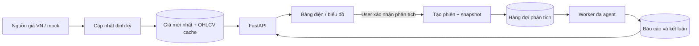

# Sau MVP1 — Bảng điện Việt Nam và phân tích từng mã

> **Scope: sau MVP1.** FR-22–FR-26, NFR-13, BR-13–BR-15 và TC-14–TC-16
> được lưu làm backlog, không chặn nghiệm thu MVP1.
> MVP1: đăng nhập → tạo phiên phân tích → theo dõi → báo cáo/lịch sử.

## 1. Định hướng mở rộng, chưa nằm trong MVP1

Sau khi hoàn thành MVP1 quản lý phiên phân tích, có thể mở rộng để người dùng theo dõi giá cổ phiếu Việt Nam, chọn mã để xem chi tiết và yêu cầu phân tích. Giá cập nhật định kỳ, có thể trễ; bản đầu của phần mở rộng ưu tiên ít tài nguyên.

Trong MVP1, danh sách phiên `/analyses` là trang chính. Khi triển khai mở rộng, **bảng điện có thể trở thành trang chính** và danh sách phiên trở thành mục “Lịch sử phân tích”. Việc chuyển này được lên lịch riêng; worker, báo cáo và hủy/thử lại của MVP1 tiếp tục được dùng.

Tài liệu này lưu phác thảo và thiết kế kỹ thuật dự kiến, không yêu cầu hiện thực hóa trong MVP1. [Prototype hiện có](../frontend/prototype.html) minh họa luồng phân tích MVP1; chưa cần bảng điện hoặc trang chi tiết cổ phiếu để nghiệm thu.

## 2. Điều hướng

| Mục | Route | Vai trò |
|---|---|---|
| Bảng điện | `/market` | Điểm vào chính sau đăng nhập; giá các mã được hỗ trợ |
| Theo dõi của tôi | `/market?view=watchlist` | Lọc bảng điện theo watchlist cá nhân |
| Chi tiết cổ phiếu | `/stocks/:instrumentId` | Giá, biểu đồ ngày và các phiên của user cho mã đó |
| Lịch sử phân tích | `/analyses` | Yêu cầu đã chạy và đang chạy của user |
| Chi tiết phân tích | `/analyses/:runId` | Tiến độ, báo cáo và kết luận đầy đủ |

## 3. Phác thảo bảng điện

```text
+----------------------------------------------------------------------------------+
| DACN  [Bảng điện] [Theo dõi của tôi] [Lịch sử phân tích]                Tài khoản  |
|----------------------------------------------------------------------------------|
| BẢNG ĐIỆN VIỆT NAM              [Tìm mã / tên...] [Sàn v] [Làm mới]               |
| Nguồn: GIẢ LẬP / NGUỒN THỰC     Giá lúc: ...     Cập nhật định kỳ                |
|----------------------------------------------------------------------------------|
| Theo dõi | Mã  | Tham chiếu | Giá gần nhất | +/- | % | Tổng KL |       Thao tác   |
|    ☆     | FPT |     —     |      —       |  —  | — |    —    | [Xem] [Phân tích] |
|    ★     | VNM |     —     |      —       |  —  | — |    —    | [Xem] [Phân tích] |
|    ☆     | HPG |     —     |      —       |  —  | — |    —    | [Xem] [Phân tích] |
|----------------------------------------------------------------------------------|
| Thiếu dữ liệu: —        Màu + dấu thể hiện tăng/giảm        [Xem thêm]             |
+----------------------------------------------------------------------------------+
```

Các mã trên chỉ minh họa bố cục, không khẳng định nguồn đã được tích hợp. Chu kỳ khoảng 30 giây là giá trị khởi đầu có thể cấu hình theo hạn mức nguồn; không có nghĩa dữ liệu nguồn mới đến từng giây.

Bản đầu của phần mở rộng dự kiến có: mã/tên/sàn, giá tham chiếu khi có, giá gần nhất, thay đổi, phần trăm, tổng khối lượng, thời điểm giá và nút phân tích. Trần/sàn chỉ bổ sung khi adapter có dữ liệu phù hợp. Sổ lệnh nhiều mức và từng giao dịch chưa nằm trong scope mở rộng ban đầu.

“Theo dõi” là watchlist mã yêu thích, không phải danh mục sở hữu hoặc tính lãi/lỗ. User có một watchlist mặc định, có thể thêm/bỏ mã.

## 4. Chi tiết mã và hành động phân tích

```text
+----------------------------------------------------------------------------------+
| < Bảng điện      FPT · Tên doanh nghiệp · Sàn       [★ Theo dõi] [Phân tích mã]   |
| Giá gần nhất: —   Thay đổi: —   Giá lúc: ...   [Dữ liệu trễ / cũ nếu có]           |
|----------------------------------------------------------------------------------|
| BIỂU ĐỒ LỊCH SỬ [1 tháng] [3 tháng] [1 năm]  | PHÂN TÍCH CỦA BẠN                |
|                                            | Ngày dữ liệu: ...                  |
| Giá và khối lượng theo ngày từ API          | [Bắt đầu phân tích]                |
|                                            | Đang xử lý · Xem tiến độ            |
|                                            | Kết quả gần nhất: ...              |
|----------------------------------------------------------------------------------|
| [Thông tin mã] [Báo cáo phân tích] [Lịch sử phân tích mã này]                       |
+----------------------------------------------------------------------------------+
```

Biểu đồ của phần mở rộng dự kiến là OHLCV theo ngày. Adapter chuẩn hóa giá về VND và khối lượng về cổ phiếu. Không tự ghép giá mới vào nến ngày đã đóng. Khung thời gian dựa trên dữ liệu nguồn hỗ trợ.

Nút “Phân tích” trên bảng điện mở form gọn đã điền mã. User kiểm tra ngày/profile rồi xác nhận. Sau khi tạo phiên, panel hiển thị tiến độ để bảng điện vẫn dùng được; có liên kết mở trang phân tích đầy đủ.

Kết quả luôn có ngày dữ liệu, thời gian tạo và mã phiên. Giá mới tới không sửa kết luận cũ hoặc tự kích hoạt LLM. User chủ động tạo phân tích mới khi cần. Snapshot giá được chọn làm ngữ cảnh chỉ được chốt ở backend lúc tiếp nhận, không lấy số do browser gửi.

## 5. Hai luồng dữ liệu độc lập



| Luồng | Tần suất | Gọi mô hình? |
|---|---|---|
| Cập nhật giá | Định kỳ, cache dùng chung | Không |
| Đọc bảng điện/biểu đồ | Theo trang/mã đang xem | Không |
| Phân tích mã | Theo yêu cầu xác nhận của user | Có, với engine live |
| Lấy tiến độ phiên | Khi phiên còn hoạt động | Không tạo lần phân tích mới |

## 6. Độ mới và tài nguyên

- Backend tập hợp giá theo lô và chia sẻ snapshot; không gọi nguồn riêng cho từng ô hoặc user.
- Chỉ đồng bộ định kỳ khi tab đang hiển thị. Lỗi nguồn giữ giá trước đó và đánh dấu dữ liệu cũ.
- `quoted_at` là thời điểm giá từ nguồn; `fetched_at` là lúc server lấy về. Fetch lại giá cũ không làm giá thành mới.
- Hiển thị độ trễ nếu nguồn công bố; chưa biết thì ghi chưa xác định. Phân biệt thị trường đóng cửa với lỗi nguồn, không đổi giá thiếu thành 0.
- PostgreSQL lưu giá gần nhất và cache OHLCV ngày; bản đầu chưa cần kho từng tick, Redis hoặc WebSocket.
- Nguồn VN, phạm vi mã và độ trễ thực tế cần được kiểm chứng ở bước tích hợp. Mock đủ để phát triển FE/BE trước.

Đối chiếu [requirements](../requirements.md), [thiết kế FE](../frontend/design.md), [thiết kế BE](../backend/design.md), [API](../backend/api-contract.md) và [mô hình dữ liệu](../backend/data-model.md).

## 7. Dịch vụ dữ liệu thị trường và bảng điện

Bảng điện là luồng đọc dữ liệu định kỳ, dùng module market_data và collector riêng. Module này không gọi graph/LLM. Collector dùng adapter VN hoặc mock, lấy theo lô một catalog nhỏ đã cấu hình cho demo và upsert quote cache/OHLCV ngày; thêm user không tạo thêm collector. Phạm vi mã được mở rộng sau khi kiểm chứng nguồn và tài nguyên.

- Một process collector cho bản đầu; nếu triển khai nhiều bản sao, phải có khóa/lease toàn cục hoặc chia partition trước để tránh fetch trùng. Không dùng cùng hàng đợi FIFO với phiên AI dài.
- Chu kỳ khởi đầu đề xuất 30 giây; cấu hình theo giới hạn provider, có timeout và backoff. Dữ liệu ngày/ngoài giờ có thể fetch thưa hơn dựa trên metadata nguồn/lịch đã xác minh, không hard-code giả định realtime.
- API đọc dữ liệu cache, không fetch nguồn ở từng request bảng điện. “Làm mới” ở UI đọc snapshot cache mới nhất, không bỏ qua hạn mức nguồn.
- Dữ liệu có instrument ID, nguồn, chế độ mock/live, đơn vị đã chuẩn hóa, ngày giao dịch, quoted_at, fetched_at, trạng thái nguồn và độ trễ nếu biết. Giá thiếu trả null.
- Cache có giá trước nhưng lần cập nhật lỗi: giữ giá trước, đánh dấu stale; chưa có dữ liệu trả unavailable. Thị trường đóng cửa là metadata riêng. Không tính giá cũ thành fresh chỉ vì vừa fetch lại.
- Giá/khối lượng chuẩn hóa về VND/cổ phiếu. OHLCV ngày có cờ adjusted và completed; không ghép dữ liệu có cách điều chỉnh khác nhau vào cùng chuỗi.
- Watchlist mặc định gắn user từ session; thêm/bỏ mã có tính idempotent, không cho browser chỉ định owner.
- Tạo phiên từ bảng điện vẫn dùng CreateAnalysis. Giá ngữ cảnh được backend chụp từ cache nếu tương thích ngày phân tích, lưu bất biến trong run; input giá do client gửi bị từ chối. Ngữ cảnh này ghi “giá lúc yêu cầu”, không thay thế bộ dữ liệu lịch sử mà engine phải kiểm tra theo as_of_date.
- Chứng khoán Việt Nam cần adapter dữ liệu/identity phù hợp. Việc có các hàm Yahoo trong repo không đồng nghĩa mọi mã VN đã phân tích được. Nút phân tích chỉ bật cho tổ hợp instrument/profile được adapter hỗ trợ.

Nếu chưa có provider, collector mock phát dữ liệu có timestamp, stale/unavailable và phiên đóng cửa để kiểm thử toàn bộ bảng điện. Nguồn live, phạm vi mã, lịch cập nhật và độ trễ là đầu ra của bước tích hợp.

## 8. Bảng điện, biểu đồ và watchlist

Các endpoint dự kiến bên dưới chỉ dành cho giai đoạn sau MVP1, dùng prefix `/api/v1`; chưa thuộc hợp đồng API bắt buộc hiện tại. Chúng dùng session; giá catalog là dữ liệu dùng chung, watchlist và kết quả phân tích vẫn riêng theo owner. PUT/DELETE yêu cầu CSRF. Đơn vị là VND/cổ phiếu; giá và phần trăm là decimal string hoặc null, khối lượng integer hoặc null.

### Quote theo lô

`GET /market/quotes` lọc theo q/exchange, sắp `(symbol, instrument_id)` ổn định, cursor opaque, limit mặc định 20/tối đa 50. `instrument_ids` nhận danh sách UUID phân cách bằng dấu phẩy, tối đa 50 để đọc watchlist; khi có danh sách ID thì không dùng cursor. Giới hạn là baseline có thể cấu hình.

```json
{
  "items": [
    {
      "instrument_id": "00000000-0000-4000-8000-000000000001",
      "symbol": "DEMO-VN",
      "exchange": "DEMO",
      "currency": "VND",
      "last_price": null,
      "reference_price": null,
      "change": null,
      "change_percent": null,
      "total_volume": null,
      "trading_date": null,
      "quoted_at": null,
      "fetched_at": null,
      "delay_seconds": null,
      "freshness": "unavailable",
      "market_state": "unknown",
      "source": "mock",
      "data_mode": "mock"
    }
  ],
  "next_cursor": null,
  "refresh_after_seconds": 30
}
```

`freshness` là `fresh`, `stale`, `unavailable`; `market_state` là `open`, `closed`, `unknown`. Freshness được backend đánh giá theo trạng thái fetch và thời điểm dữ liệu kỳ vọng của nguồn, không chỉ fetched_at. Delay null nghĩa chưa xác định; không suy ra realtime. Instrument có trong catalog nhưng thiếu quote vẫn xuất hiện với giá null/unavailable; ID không hợp lệ hoặc không được hỗ trợ bị báo lỗi chuẩn.

Nguồn lỗi nhưng cache còn dùng được trả `200` với stale và metadata trước đó. Mỗi dòng giữ quoted_at riêng; lấy lại giá cũ không đổi timestamp này. UI “Làm mới” chỉ đọc cache; không yêu cầu provider chạy ngoài lịch.

### OHLCV ngày

`GET /instruments/{id}/ohlcv` nhận from/to theo ngày, khoảng `[from, to]`, interval chỉ `1d`; baseline tối đa 366 ngày để giới hạn payload. Không có dữ liệu trả `200` và items rỗng; interval ngoài phạm vi trả `422`. Response:

```json
{
  "instrument_id": "00000000-0000-4000-8000-000000000001",
  "interval": "1d",
  "currency": "VND",
  "volume_unit": "shares",
  "timezone": "Asia/Ho_Chi_Minh",
  "adjusted": false,
  "data_mode": "mock",
  "source": "mock",
  "items": [],
  "freshness": "unavailable",
  "fetched_at": null
}
```

Mỗi item có `date`, `open`, `high`, `low`, `close` (decimal string), `volume` (integer/null), `is_complete` (boolean). Sắp theo date tăng; một response có cùng source/adjusted. Giá hiện tại không được frontend tự ghi đè vào chuỗi nến ngày.

### Watchlist và phân tích từ mã

`GET /watchlist` trả `{ "items": [{ "instrument_id": "...", "added_at": "..." }] }`, mới thêm trước, baseline tối đa 50 mã. PUT mã đã tồn tại hoặc DELETE mã chưa có đều trả `204`; không làm phát sinh bản ghi trùng. Instrument không được hỗ trợ trả `404`; thêm vượt hạn mức trả `422 WATCHLIST_LIMIT`.

Nút phân tích dùng nguyên `POST /analyses` với instrument_id/ngày/profile/ngôn ngữ; không nhận giá do browser gửi. Backend có thể lưu `quote_context` nội bộ và trả cùng tên trong snapshot run: giá lúc tiếp nhận, nguồn, quoted_at, fetched_at, trading_date và data_mode, hoặc null nếu không tương thích ngày. Snapshot này không thay đổi theo quote mới. Kết quả lịch sử và dữ liệu bảng điện hiện tại luôn được trình bày theo thời điểm riêng.

## 9. Dữ liệu bảng điện và watchlist

Chỉ bổ sung các bảng dưới đây và trường JSONB nullable `analysis_runs.quote_context` khi triển khai phần mở rộng. ERD/migration của MVP1 không phụ thuộc chúng.

### `watchlist_items`

Composite PK `(owner_id, instrument_id)` cùng FK users/instruments; thêm `added_at`. Một watchlist mặc định cho mỗi user, không trùng mã. Hạn mức baseline 50 mã, kiểm tra quota dưới khóa user để thêm đồng thời vẫn đúng. PUT lặp không đổi thời gian thêm; DELETE chỉ xóa của owner từ session.

### `market_quotes`

Composite PK `(instrument_id, source, data_mode)`. Các trường: `last_price`, `reference_price`, `change`, `change_percent` (numeric nullable), `total_volume` (bigint nullable), `trading_date` (date nullable), `quoted_at`, `fetched_at`, `last_attempt_at` (timestamptz nullable), `delay_seconds` (integer nullable), `market_state`, `last_fetch_error_code` (nullable). Capability/cấu hình server chọn một source đang hoạt động cho mỗi instrument/mode khi đọc API.

Giá dùng VND, khối lượng cổ phiếu; adapter chuyển đơn vị trước khi lưu. Collector upsert snapshot mới, không thêm bản ghi mỗi tick. Lỗi fetch không ghi đè giá/quoted_at đã có; ghi last_attempt/error để API đánh giá stale. Freshness là view tính từ cache và metadata nguồn; thị trường closed không tự có nghĩa lỗi nguồn. Index phục vụ đọc theo instrument/source/mode.

### `daily_candles`

Composite PK `(instrument_id, source, data_mode, adjusted, date)`; OHLC dùng numeric, volume bigint nullable, `is_complete` boolean và fetched_at. Một series có cùng source/mode/adjusted. Collector upsert dữ liệu ngày; khi nguồn sửa một candle, cache có thể cập nhật nhưng quote_context của run cũ không bị đổi.

Các bảng market là cache dùng chung theo quyền catalog, không chứa owner. Watchlist và analysis_runs vẫn có owner riêng. quote_context chỉ lưu khi dữ liệu phù hợp as_of_date; không chép giá hiện tại vào phân tích quá khứ. Full snapshot lịch sử phục vụ tái lập kết quả nằm ngoài khả năng bảo đảm của cache giá mới nhất này.
