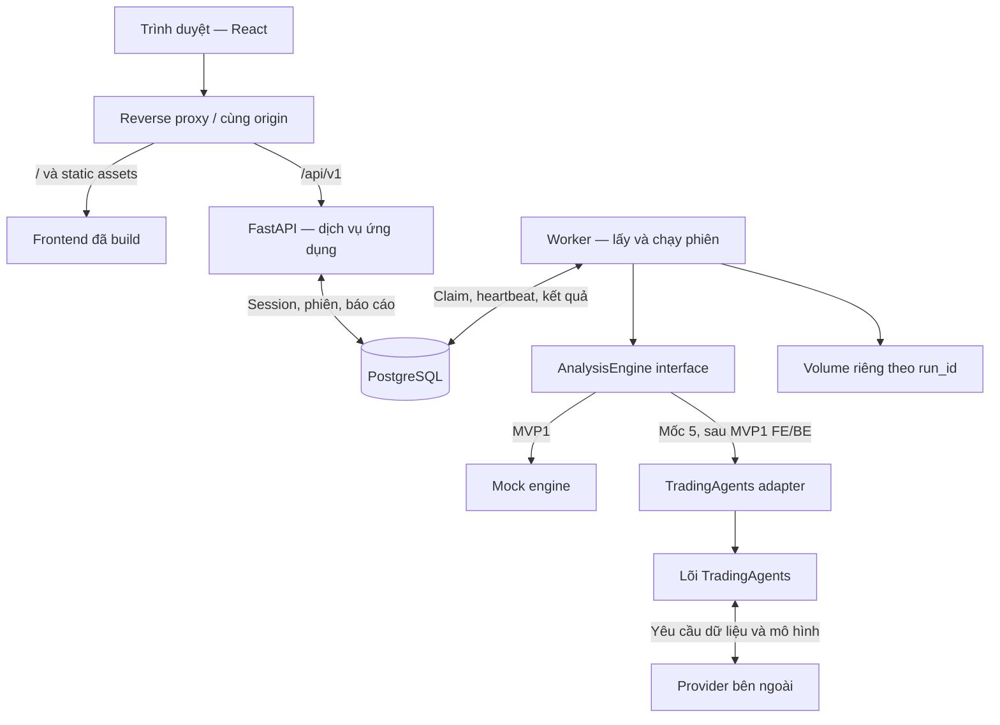
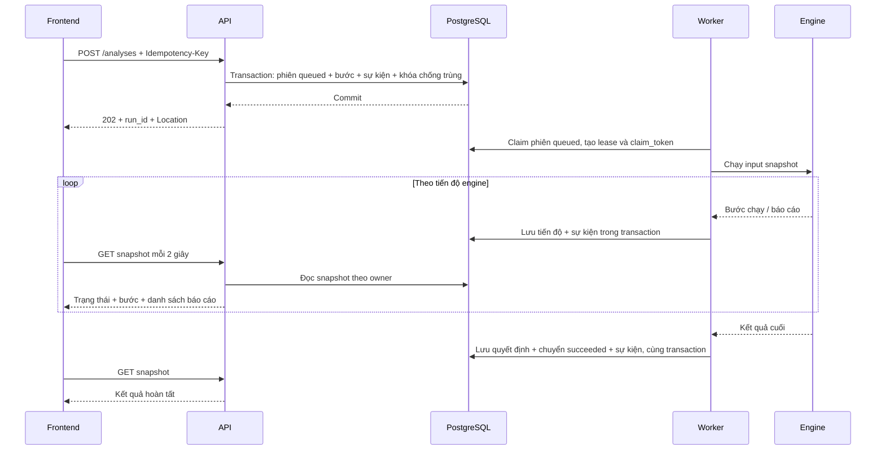

# Kiến trúc hệ thống

Các yêu cầu, phạm vi và tiêu chí nghiệm thu được quản lý tập trung tại [requirements.md](requirements.md). Tài liệu này mô tả phương án kiến trúc đáp ứng các yêu cầu đó.

**Phạm vi MVP1:** quản lý phiên phân tích theo luồng ban đầu. Bảng điện, watchlist, biểu đồ và collector giá chỉ thuộc [backlog sau MVP1](planning/post-mvp-market-workspace.md); không có trong sơ đồ triển khai bắt buộc dưới đây.

## 1. Bài toán và phạm vi

Người dùng cần gửi một yêu cầu phân tích, biết yêu cầu đang ở bước nào, đọc kết quả và tra cứu lại về sau. Một phiên có thể chạy lâu, lỗi do nguồn ngoài hoặc bị gián đoạn khi người dùng đóng trình duyệt. Vì vậy, vòng đời phiên thuộc backend và tồn tại độc lập với trang web đang mở.

MVP hướng tới một nhóm nghiên cứu hoặc một lớp học, với số người dùng và số phiên chạy đồng thời nhỏ. Thiết kế cần kiểm chứng luồng sản phẩm trước khi tối ưu thông lượng.

| Chức năng | Kết quả người dùng nhận được |
|---|---|
| Đăng nhập, đăng xuất | Không gian lịch sử cá nhân |
| Tìm đối tượng phân tích | Danh sách mã, sàn, loại tài sản và khả năng hỗ trợ |
| Tạo phiên | Mã phiên và trang theo dõi ngay sau khi gửi |
| Theo dõi | Trạng thái, bước hiện tại, thời gian chạy và báo cáo đã có |
| Đọc kết quả | Kết luận, các báo cáo và cảnh báo chất lượng |
| Hủy hoặc thử lại | Yêu cầu hủy có trạng thái rõ; lần thử lại là một phiên mới |
| Tra cứu lịch sử | Lọc theo mã, trạng thái và khoảng thời gian |

Tài khoản được tạo bằng lệnh quản trị trong giai đoạn đầu. Luồng tự đăng ký, khôi phục mật khẩu và giao diện quản trị chưa nằm trong MVP.

## 2. Khảo sát mã nguồn hiện tại

Đây là các quan sát từ code, không phải tính năng đã có trên web:

| Thành phần | Có thể tận dụng | Khoảng trống của lớp ứng dụng |
|---|---|---|
| `tradingagents/graph/trading_graph.py` | Thực thi graph, state, checkpoint và xuất báo cáo | Chưa có HTTP API, quyền sở hữu phiên hay mã phiên ứng dụng |
| `tradingagents/graph/setup.py` | Các node và quan hệ thực thi | Cần chuyển trạng thái engine thành tiến độ hiển thị |
| `tradingagents/agents/rating.py` | Năm mức khuyến nghị và giá trị `REVIEW` | Cần hợp đồng JSON và nhãn tiếng Việt |
| `tradingagents/reporting.py` | Báo cáo Markdown theo phần | Cần lưu trữ và endpoint có kiểm tra quyền |
| `tradingagents/graph/checkpointer.py` | SQLite checkpoint theo ticker và chữ ký cấu hình | Cần cô lập theo phiên ứng dụng |
| `cli/` | Cách gọi engine và trình bày trên terminal | Chưa phải frontend web; có xử lý trạng thái gắn với terminal |

## 3. Thành phần triển khai

API và worker dùng chung backend codebase và các quy tắc nghiệp vụ, được chạy bằng hai entrypoint khác nhau. API tiếp nhận và đọc dữ liệu; worker thực thi tác vụ dài. Worker không cần một HTTP server riêng.

MVP1 chỉ chọn MockEngine. Nhánh TradingAgents/provider bên ngoài là phần tích hợp ở mốc 5, không phải điều kiện chạy luồng mock hoặc nghiệm thu MVP1.

Trong môi trường local, có thể dùng Vite dev proxy cho `/api`; môi trường triển khai dùng reverse proxy và HTTPS. PostgreSQL và volume kết quả chỉ được truy cập từ các dịch vụ nội bộ.

## 4. Quyết định công nghệ và lý do

| Quyết định | Lý do | Giới hạn cần biết |
|---|---|---|
| React + TypeScript + Vite | Giao diện ứng dụng nhiều trạng thái; kiểu dữ liệu FE/BE rõ; build static đơn giản | SEO không phải yêu cầu của các trang sau đăng nhập |
| React Router + TanStack Query | Tách điều hướng và cache dữ liệu server; hỗ trợ polling | Mutation phải xử lý idempotency cùng backend |
| FastAPI + Pydantic | Dùng trực tiếp hệ sinh thái Python hiện có; tạo OpenAPI từ schema | Chạy engine dài trong worker |
| SQLAlchemy + Alembic | Transaction, truy vấn và migration có phiên bản | Mỗi request hoặc luồng worker cần session riêng |
| PostgreSQL làm hàng đợi ban đầu | Tạo phiên và đưa phiên vào trạng thái chờ trong một transaction; giảm dịch vụ vận hành | Chỉ dành cho khối lượng nhỏ; phải có lease và xử lý worker mất kết nối |
| Polling có điều kiện | Dễ thử nghiệm, phục hồi sau refresh và tái kết nối | Tiến độ có độ trễ khoảng một chu kỳ polling |
| Session cookie cùng origin | Browser không phải giữ bearer token trong localStorage | Cần CSRF, cấu hình cookie và kiểm tra origin |

PostgreSQL có hỗ trợ `FOR UPDATE SKIP LOCKED` cho các consumer truy cập bảng kiểu hàng đợi. Chỉ dùng cơ chế này trong truy vấn claim tác vụ, không dùng nó cho truy vấn lịch sử thông thường. [Tài liệu PostgreSQL](https://www.postgresql.org/docs/current/sql-select.html)

Khi số lượng phiên tăng đáng kể, có thể đưa broker vào sau `JobRepository`. Khi cần cập nhật nhanh hơn, bổ sung SSE trên các sự kiện đã lưu. Hai thay đổi này không làm đổi resource phân tích hay giao diện engine.

## 5. Luồng tạo và hoàn tất phiên

Một request tạo phiên thành công chỉ có nghĩa là yêu cầu đã được lưu bền vững. Worker có thể nhận việc sau đó. Khi worker tạm ngừng, phiên vẫn ở hàng đợi và có thể được xử lý khi worker hoạt động lại.

## 6. Ranh giới và nguyên tắc

- Frontend chỉ biết API; tên node, prompt và cấu hình provider được chuyển đổi tại adapter.
- Backend xác định người sở hữu từ session, không nhận `owner_id` do browser cung cấp.
- Dữ liệu trên PostgreSQL là nguồn trạng thái chính; refresh trang không làm khởi chạy lại engine.
- Mỗi phiên có input/config snapshot bất biến, engine instance, thư mục kết quả và checkpoint riêng.
- Trạng thái thực thi tách khỏi chất lượng kết luận. `succeeded` có thể đi cùng `decision.quality = needs_review`.
- Giới hạn thời gian, số phiên đang hoạt động và kích thước báo cáo được cấu hình phía server.
- Mọi kết quả giả lập mang nhãn `mock` trên API và giao diện.

## 7. Thông số khởi đầu để kiểm thử

| Thông số | Giá trị ban đầu |
|---|---|
| Worker concurrency | 1 phiên/process |
| Polling trang chi tiết | 2 giây khi tab đang hiển thị và phiên hoạt động |
| Polling lịch sử có phiên hoạt động | 5 giây |
| Heartbeat worker | 10 giây |
| Lease | 60 giây, được gia hạn bởi heartbeat hợp lệ |
| Thời gian tối đa một phiên | 15 phút, kiểm tra lại khi tích hợp engine thật |
| Số phiên hoạt động mỗi người dùng | 2, tính cả queued/running/cancel_requested |

Lease đo bằng thời gian PostgreSQL. Các timestamp lưu UTC; frontend định dạng theo timezone người dùng. `as_of_date` là ngày nghiệp vụ theo timezone của đối tượng phân tích.

API lấy một instant UTC và chuyển sang timezone IANA của instrument để xác định ngày hiện tại, giới hạn catalog và validation. Adapter truyền timezone snapshot thành `business_timezone` trong context của từng run; các helper kiểm tra ngày và phân loại historical/live của lõi phải dùng cùng quy tắc khi tích hợp mốc 5. Không đổi timezone toàn process. Các khoảng dữ liệu theo ngày được đổi từ ranh giới ngày nghiệp vụ sang UTC khi cần so timestamp. Thiết kế chi tiết và ca kiểm thử ranh giới ngày nằm tại [backend](backend/design.md#ngày-nghiệp-vụ-giữa-api-và-engine); đây là công việc dự kiến, chưa phải hành vi đã triển khai.

## 8. Tài liệu kỹ thuật tham chiếu

- [React với TypeScript](https://react.dev/learn/typescript).
- [FastAPI và cấu trúc ứng dụng nhiều module](https://fastapi.tiangolo.com/tutorial/bigger-applications/).
- [TanStack Query: refetchInterval](https://tanstack.com/query/latest/docs/framework/react/reference/useQuery).
- [SQLAlchemy: vòng đời và phạm vi Session](https://docs.sqlalchemy.org/en/20/orm/session_basics.html).

Các nguồn này dùng để kiểm tra lựa chọn kỹ thuật; chức năng sản phẩm được xác định trong bộ thiết kế này.
